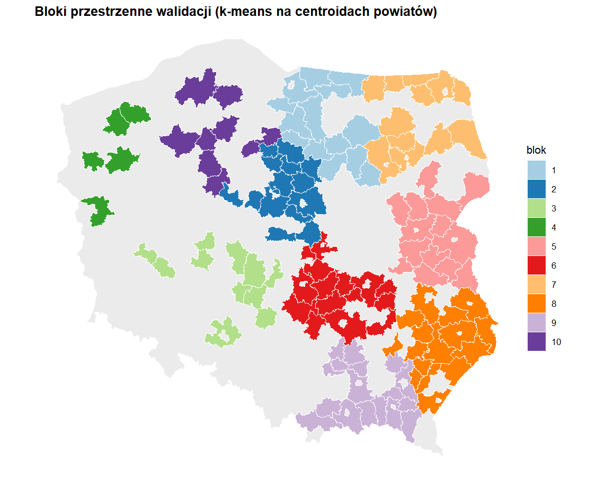

```{r setup, include=FALSE}
knitr::opts_chunk$set(echo = FALSE, message = FALSE, warning = FALSE)
suppressPackageStartupMessages({library(dplyr); library(knitr)})
OUT <- "outputs"
wcz <- function(f) read.csv(file.path(OUT, f), stringsAsFactors = FALSE,
                            check.names = FALSE, fileEncoding = "UTF-8")
f2 <- function(x, d = 2) formatC(x, format = "f", digits = d, decimal.mark = ",")
pc <- function(x, d = 1) paste0(f2(100 * x, d), "%")

zakresy   <- wcz("zakresy_modeli.csv")
klasy     <- wcz("klasy_peryferyjnosci.csv")
wsp       <- wcz("wspolczynniki_regresji.csv")
bench     <- wcz("porownanie_modeli_panelowych.csv")
det       <- wcz("porownanie_xgb_demograficzny_strukturalny.csv")
strojenie <- wcz("strojenie_xgb_peryferie.csv")
walid     <- wcz("walidacja_antyprzeuczeniowa_xgb.csv")
pokr      <- wcz("pokrycie_przedzialow_xgb.csv")
pokr_h    <- wcz("pokrycie_horyzontow_xgb.csv")
kalibr    <- wcz("kalibracja_przedzialow_xgb.csv")
imp       <- wcz("xgb_permutation_importance.csv")
boot      <- wcz("xgb_importance_bootstrap.csv")
cv_gw     <- wcz("gwxgb_cv_pasmo.csv")
shap_gw   <- wcz("gwxgb_lokalne_shap.csv")
gw_test   <- wcz("gwxgb_lokalne_testy_permutacyjne.csv")
moran     <- wcz("autokorelacja_przestrzenna_xgb.csv")
przestrz  <- wcz("porownanie_xgb_przestrzenny.csv")
prognoza  <- wcz("prognoza_do_2030.csv")
ranking   <- wcz("ranking_ryzyka_depopulacji_2030.csv")
scen      <- wcz("scenariusze_podsumowanie.csv")
scen_por  <- wcz("scenariusze_porownanie_modeli.csv")
waz_por   <- wcz("waznosc_cech_enet_vs_xgb.csv")
waz_sp    <- wcz("waznosc_cech_spearman.csv")
det_dm    <- wcz("determinanty_dm.csv")
progi_st  <- wcz("progi_ale_stabilnosc.csv")
scen_bt   <- wcz("scenariusze_bootstrap.csv")
int_rank  <- wcz("interakcje_ranking.csv")
int_wal   <- wcz("interakcje_walidacja.csv")
int_okna  <- wcz("interakcje_pary_okna.csv")

n_pow <- zakresy$powiaty[zakresy$zbior == "panel_clean"]
rmse_m <- function(m) bench$rmse_srednie[bench$model == m]
najlepszy <- bench$model[which.min(bench$rmse_srednie)]
q90 <- kalibr$q90[kalibr$grupa == "wszystkie"]

ETYK <- c(doch_wlasne_pc = "dochody własne pc", udzial_wyd_inwest = "udział wydatków inwestycyjnych",
          bezrobocie_rejestrowane = "bezrobocie rejestrowane", wage_rel = "płace względem kraju",
          podmioty_1000 = "firmy / 1000 mieszk.", kanalizacja_pct = "kanalizacja %",
          lekarze_10tys = "lekarze / 10 tys.", udzial_65_plus = "udział 65+",
          gestosc_zaludnienia = "gęstość zaludnienia (log)", odl_stolica_km = "odległość od miasta woj.",
          rok = "rok (trend)", x = "współrzędna x", y = "współrzędna y")
et <- function(v) {
  baza <- sub("_lag[12]$", "", v)
  lag <- ifelse(grepl("_lag1$", v), " (t−1)", ifelse(grepl("_lag2$", v), " (t−2)", ""))
  paste0(ifelse(baza %in% names(ETYK), ETYK[baza], baza), lag)
}
# modele determinantów (XGBoost, EN, ALE) używają gęstości w os./km², nie w logarytmie
et_det <- function(v) sub(" (log)", " [os./km²]", et(v), fixed = TRUE)
```

<style>.leaflet-container { background: #ffffff !important; }</style>

```{r interaktywne, include=FALSE}
# Interaktywne wykresy (plotly) i mapy (leaflet). Pliki PNG w outputs/ zostają
# do plakatu; raport HTML pokazuje wersje interaktywne.
suppressPackageStartupMessages({library(plotly); library(leaflet); library(sf)})
PL <- function(p) p %>% config(displaylogo = FALSE, locale = "pl") %>%
  layout(font = list(family = "Arial"), hoverlabel = list(align = "left"))

mapowanie <- read.csv("powiaty_mapowanie_kodow.csv", colClasses = "character", fileEncoding = "UTF-8") %>%
  transmute(JPT_KOD_JE = sprintf("%04d", as.integer(JPT_KOD_JE)), kod_powiatu = trimws(kod_powiatu))
gr <- st_read("powiaty.geojson", quiet = TRUE)
gr$JPT_KOD_JE <- sprintf("%04d", as.integer(gr$JPT_KOD_JE))
gr <- merge(gr, mapowanie, by = "JPT_KOD_JE", all.x = TRUE)
gr <- gr %>% st_make_valid() %>% st_transform(2180) %>%
  st_simplify(preserveTopology = TRUE, dTolerance = 1200) %>% st_transform(4326) %>%
  transmute(kod_powiatu, nazwa = JPT_NAZWA_)

# Mapa: dane `df` (kod_powiatu + kolumny) dołączone do granic; `kol` = zmienna koloru,
# `pal` = paleta leaflet, `etyk` = funkcja (wiersz -> tekst podpowiedzi).
mapa <- function(df, kol, pal, etyk, tytul, wartosci_legendy = NULL, lab_format = labelFormat()) {
  df$kod_powiatu <- as.character(df$kod_powiatu)
  g <- gr %>% left_join(df, by = "kod_powiatu")
  tekst <- ifelse(is.na(g[[kol]]), paste0(nz(g), "<br><i>poza próbą</i>"), etyk(g))
  tekst <- lapply(unname(tekst), htmltools::HTML)   # nazwy wektora psułyby JSON etykiet
  m <- leaflet(g, options = leafletOptions(zoomSnap = 0.25, attributionControl = FALSE)) %>%
    addPolygons(fillColor = ~pal(g[[kol]]), fillOpacity = 0.85, color = "white", weight = 0.4,
                label = tekst, highlightOptions = highlightOptions(weight = 2, color = "#333", bringToFront = TRUE)) %>%
    addLegend("bottomright", pal = pal, values = if (is.null(wartosci_legendy)) g[[kol]] else wartosci_legendy,
              title = tytul, na.label = "poza próbą", labFormat = lab_format, opacity = 0.9) %>%
    fitBounds(14.1, 48.95, 30.3, 54.9)   # miejsce na legendę po prawej, poza obszarem Polski
  m
}
nz <- function(g) paste0("<b>", g$nazwa, "</b>")
pl_klasa <- c(peryferyjne = "peryferie", polperyferyjne = "półperyferie", rdzeniowe = "rdzeń")
```

## 1. Cel i pytanie badawcze

**Hipoteza:** wzrost peryferyjności powiatu (niski dochód, słaby rynek pracy, starzenie się
ludności, słabsza dostępność usług i większa odległość od ośrodków) wiąże się z szybszym
odpływem mieszkańców.

Projekt łączy trzy elementy z tytułu:

1. **Predykcja:** prognoza rocznej zmiany ludności powiatów peryferyjnych na lata 2025–2030,
   z modelu wybranego w porównaniu 13 modeli (elastic net) i z walidacją ex ante na latach,
   których model nie widział.
2. **GIS:** klasyfikacja przestrzenna 380 powiatów, odległość od miast wojewódzkich, autokorelacja
   przestrzenna (Moran I, LISA), lokalny model GW-XGBoost oraz mapy prognoz i scenariuszy.
3. **Machine Learning a ekonometria:** XGBoost porównany z panelowym modelem efektów stałych (FE)
   w identycznym schemacie walidacji.

### Rola poszczególnych modeli

Żaden model nie jest najlepszy do wszystkiego, dlatego każde pytanie badawcze ma przypisany
model, który odpowiada na nie najlepiej. Kluczowe wyniki sprawdzamy drugim modelem.

| Pytanie | Model główny | Dlaczego | Kontrola odporności |
|---|---|---|---|
| Jak zmieni się ludność do 2030 r.? (mapa przyszłości) | elastic net | najniższy błąd ex ante; istotnie lepszy od FE (test DM z korektą Holma) | prognoza XGBoost (sekcja 6) |
| Jakie czynniki i w którą stronę? | panel FE, SDM | interpretowalne współczynniki, istotność, efekty sąsiedztwa | ważność cech w EN i XGBoost (sekcja 4) |
| Czy zależności są nieliniowe, gdzie są progi? | XGBoost (krzywe ALE) | model liniowy z definicji nie wykryje progu | stabilność progów w 6 oknach uczących; czy progi poprawiają model liniowy (sekcja 4) |
| Czy mechanizm różni się w przestrzeni? | GW-XGBoost | wymaga modelu lokalnego | lokalne testy permutacyjne z FDR |
| Co dałyby interwencje? | hybryda: elastic net + progi z ALE | najniższy błąd wśród modeli determinantów (przewaga nieistotna), a jednocześnie uwzględnia progi | te same scenariusze w XGBoost i czystym elastic net (sekcja 8) |

Zmienna zależna: **roczna zmiana ludności na 1000 mieszkańców** (‰), winsoryzowana na 1. i 99. percentylu
(artefakty zmian granic administracyjnych).

## 2. Dane i klasyfikacja peryferyjności

```{r}
kable(zakresy %>% select(Zbiór = zbior, Obserwacje = obserwacje, Powiaty = powiaty,
                         `Od` = rok_min, `Do` = rok_max, Uwagi = uwaga))
```

**Indeks rdzeniowości** = średnia ze standaryzowanych: log gęstości zaludnienia, płac względem
średniej krajowej, firm na 1000 mieszkańców i dochodów własnych pc. Indeks liczymy
**dla wszystkich `r nrow(klasy)` powiatów na latach bazowych 2011–2013** i dzielimy go na tercyle.
Do dalszej analizy trafia najniższy tercyl (`r n_pow` powiatów peryferyjnych).

Klasyfikacja opiera się na okresie bazowym, a nie na roku 2024. Klasa z 2024 r. odzwierciedlałaby
już skutki depopulacji, którą następnie modelujemy, czyli próba byłaby dobrana na podstawie wyniku.

```{r}
kl <- klasy %>% mutate(klasa_pl = factor(pl_klasa[klasa], levels = pl_klasa))
mapa(kl, "klasa_pl", colorFactor(c("#b2182b", "#f4a582", "#4393c3"), levels = pl_klasa, na.color = "#e3e3e3"),
     function(g) paste0(nz(g), "<br>klasa: ", g$klasa_pl, "<br>indeks rdzeniowości: ", f2(g$indeks_rdzeniowosci, 2)),
     "Klasa (2011–2013)")
```

```{r}
pcl <- wcz("panel_clean.csv")
tr <- pcl %>% group_by(rok) %>%
  summarise(udzial = 100 * mean(zmiana_ludnosci_1000 < 0, na.rm = TRUE),
            mediana = median(zmiana_ludnosci_1000, na.rm = TRUE),
            q25 = quantile(zmiana_ludnosci_1000, .25, na.rm = TRUE),
            q75 = quantile(zmiana_ludnosci_1000, .75, na.rm = TRUE), .groups = "drop")
plot_ly(tr, x = ~rok) %>%
  add_bars(y = ~udzial, name = "% powiatów ze spadkiem", marker = list(color = "rgba(204,68,68,0.35)"),
           hovertemplate = "%{x}: %{y:.0f}% powiatów ze spadkiem<extra></extra>") %>%
  add_ribbons(ymin = ~q25, ymax = ~q75, yaxis = "y2", name = "kwartyle (25–75%)",
              fillcolor = "rgba(34,34,85,0.15)", line = list(width = 0), hoverinfo = "skip") %>%
  add_lines(y = ~mediana, yaxis = "y2", name = "mediana zmiany ludności", line = list(color = "#222255", width = 3),
            hovertemplate = "%{x}: mediana %{y:.2f}‰<extra></extra>") %>%
  layout(title = "Postępująca depopulacja powiatów peryferyjnych, 2011–2024",
         yaxis = list(title = "% powiatów ze spadkiem ludności", range = c(0, 100)),
         yaxis2 = list(title = "zmiana ludności [‰]", overlaying = "y", side = "right", zeroline = TRUE,
                       showgrid = FALSE, automargin = TRUE),
         xaxis = list(title = ""), legend = list(orientation = "h", y = -0.15),
         margin = list(r = 80)) %>% PL()
```

## 3. Determinanty: pooled OLS i panel FE

Wszystkie predyktory wchodzą **z opóźnieniem t−1** i są standaryzowane (beta oznacza efekt
zmiany o 1 odchylenie standardowe, w ‰). We wcześniejszej wersji predyktory pochodziły z tego
samego roku. Wtedy gęstość zaludnienia (= ludność / powierzchnia) oraz wskaźniki per capita
zmieniały się *z definicji* razem ze zmianą ludności, co dawało mechaniczne, zawyżone współczynniki.

```{r}
tab_wsp <- wsp %>%
  mutate(zmienna = et(zmienna),
         wartosc = paste0(f2(beta, 3), ifelse(p < .01, "***", ifelse(p < .05, "**", ifelse(p < .1, "*", ""))))) %>%
  select(model, zmienna, wartosc) %>%
  tidyr::pivot_wider(names_from = model, values_from = wartosc)
kable(tab_wsp, col.names = c("Predyktor (t−1)", names(tab_wsp)[-1]),
      caption = "Standaryzowane współczynniki; SE klastrowane po powiecie; *** p<0,01, ** p<0,05, * p<0,1")
r2 <- wsp %>% distinct(model, r2)
```

R² modelu pooled = `r f2(r2$r2[r2$model == "pooled OLS"], 3)`, R² within modelu FE =
`r f2(r2$r2[r2$model == "FE (powiat + rok)"], 3)`. Test Hausmana odrzuca model RE na rzecz FE.

**Interpretacja.** Między powiatami (pooled) najsilniej z depopulacją wiąże się **wysoki udział osób
65+**, a w drugiej kolejności wysokie bezrobocie i niska gęstość zaludnienia. W wymiarze
*within* (FE: zmiany w czasie w tym samym powiecie) utrzymuje się efekt starzenia. Pozostałe
zależności są słabe, bo cechy strukturalne zmieniają się powoli, a większość zróżnicowania pochłaniają
efekty stałe powiatów.

## 4. Machine Learning: prognoza i porównanie z FE

Walidacja krocząca ex ante: dla każdego roku testowego 2019–2024 model uczy się wyłącznie na
latach wcześniejszych. Hiperparametry XGBoost dobrano na oknie 2015–2018, czyli przed pierwszym
rokiem testowym (wybrany wariant: `r strojenie$wariant[1]`).

```{r}
kable(bench %>% transmute(Model = model, `RMSE średni [‰]` = f2(rmse_srednie, 3),
                          `SD między latami` = f2(rmse_sd, 3)))
```

```{r, results='asis'}
if (najlepszy == "FE panelowy") {
  cat(sprintf("**W porównaniu bazowym FE ma niższy błąd niż XGBoost** (RMSE %s‰ wobec %s‰). ",
              f2(rmse_m("FE panelowy"), 3), f2(rmse_m("XGBoost globalny"), 3)),
      "Przy krótkim panelu (127 powiatów, kilkanaście lat) i silnej bezwładności depopulacji",
      "prosta struktura liniowa wystarcza; nieliniowości wychwytywane przez XGBoost nie przekładają się",
      "na niższy błąd. Oba modele są lepsze od prognozy naiwnej („jak w poprzednim roku”).",
      "Lokalna korekta reszt sąsiadów nie poprawia prognozy.",
      "To porównanie obejmuje tylko dwa modele. Pełny test 13 modeli poniżej wyłania model jeszcze lepszy",
      "od FE, czyli **elastic net**, który generuje mapę przyszłości (sekcja 6).\n")
} else {
  cat(sprintf("**Najniższy błąd prognozy daje model: %s.**\n", najlepszy))
}
```

### Test odporności: czy inny model ML poradzi sobie lepiej?

FE ma przewagę konstrukcyjną: osobną stałą dla każdego powiatu, której XGBoost nie widzi.
Sprawdziliśmy więc szerokie spektrum modeli w **identycznej** walidacji kroczącej 2019–2024:

- **XGBoost dostrojony**: losowe przeszukanie 200 konfiguracji hiperparametrów (ta sama procedura co dla modelu determinantów, opis niżej), walidacja krocząca na latach 2017–2018, czyli przed okresem testowym,
- **XGBoost + średnia powiatu**: historyczna średnia zmiany ludności powiatu jako cecha (odpowiednik efektu stałego),
- **XGBoost within (hybryda FE)**: cel i cechy pomniejszone o średnie powiatu, a XGBoost modeluje odchylenia, tak jak transformacja within w FE,
- **sieć neuronowa MLP**: liczba neuronów i regularyzacja strojone na latach 2017–2018, średnia z 5 inicjalizacji,
- **Random Forest** i **Geographical Random Forest**: las lokalny na k najbliższych powiatach zmieszany z lasem globalnym (Georganos i in. 2019),
- **elastic net** (regresja regularyzowana) oraz **ensemble** FE i XGBoost,
- **hybryda elastic net + progi z ALE**: elastic net z cechami łamanymi max(x − próg, 0) dla progów wykrytych
  przez XGBoost. Progi są wyznaczane w każdym oknie tylko na latach uczących,
- **połączenie ML i SDM**: XGBoost oraz elastic net z cechami modelu Durbina, czyli średnimi z sąsiadów
  granicznych z roku t−1 dla predyktorów (W·X) i zmiany ludności (W·y), na tej samej macierzy W co w SDM.
  Sąsiedzi obejmują też powiaty spoza peryferii.

**Strojenie hiperparametrów.** Żeby porównanie było uczciwe, każdy model z hiperparametrami został
dostrojony w tym samym oknie walidacyjnym (lata 2017–2018, model uczony na latach wcześniejszych),
czyli **przed** pierwszym rokiem testowym. Lata testowe 2019–2024 nie wpływają na wybór ustawień.
Wyjątkiem jest elastic net, który ma tylko dwa hiperparametry. W każdym oknie walidacji kroczącej
dobiera je na ostatnim roku uczącym, więc również bez dostępu do roku testowego. FE nie ma hiperparametrów.

```{r}
str_ml <- wcz("strojenie_modeli_ml.csv")
kable(str_ml %>% transmute(Model = model, Metoda = metoda, `Liczba konfiguracji` = konfiguracje,
                           `Wybrane ustawienia` = wybrane,
                           `RMSE walidacji 2017–2018` = ifelse(is.na(rmse_walidacja_2017_2018), "–",
                                                              f2(rmse_walidacja_2017_2018, 3))))
```

**Czy strojenie coś zmieniło?** Nie zmieniło kolejności modeli. W poprzednim przebiegu, na ustawieniach
domyślnych, Random Forest miał w latach testowych RMSE 2,188‰, Geographical RF 2,174‰, a MLP (siatka 12 konfiguracji) 2,254‰.
Po strojeniu wyniki testowe są podobne albo nieco gorsze (tabela poniżej), mimo lepszego wyniku w oknie
walidacyjnym. Dwa lata walidacji to za mało, żeby wiarygodnie dobrać ustawienia modeli drzewiastych, i to kolejny
argument, że przy tej wielkości próby przewagę mają proste modele z regularyzacją. Dla elastic net
sprawdziliśmy gęstszą siatkę α (0; 0,1; …; 1). Nie obniżyła błędu (2,068‰ wobec 2,065‰), więc pozostała
siatka {0,2; 0,5; 0,8; 1}. Prognoza do 2030 r. z gęstszą siatką wynosiłaby −5,7% zamiast −5,3%, co
pokazuje skalę niepewności związanej z samą specyfikacją modelu.

Istotność różnic względem FE wyznacza panelowy test Diebolda-Mariano: regresja różnicy kwadratów
błędów na stałą z SE klastrowanymi po powiecie (ujemna różnica oznacza model lepszy od FE).
Wartości p skorygowano **metodą Holma**, bo testujemy wiele modeli na tych samych latach,
co zwiększa ryzyko znalezienia „zwycięzcy” przypadkiem.

```{r}
ml <- wcz("porownanie_modeli_ml.csv")
fp <- function(p) ifelse(is.na(p), "–", formatC(p, format = "g", digits = 2))
kable(ml %>% transmute(Model = model, `RMSE średni [‰]` = f2(rmse_srednie, 3),
                       `Lata lepszy od FE (z 6)` = ifelse(model == "FE panelowy", "–", lat_lepszy_od_FE),
                       `DM: różnica vs FE` = ifelse(is.na(dm_srednia_roznica), "–", f2(dm_srednia_roznica, 3)),
                       `p (DM)` = fp(dm_p), `p Holm` = fp(dm_p_holm)))
naj_ml <- ml$model[1]
istotne <- ml$model[!is.na(ml$dm_p_holm) & ml$dm_p_holm < .05 & ml$dm_srednia_roznica < 0]
xgb_p <- ml$dm_p_holm[ml$model == "XGBoost"]
```

**Wnioski z testu odporności:**

1. Po korekcie Holma istotnie lepsze od FE są tylko modele z rodziny elastic net: **`r paste(istotne, collapse = "** oraz **")`**,
   czyli regresja regularyzowana i liniowa. Najniższy błąd ma `r naj_ml` (RMSE `r f2(ml$rmse_srednie[1], 3)`‰).
2. Żaden wariant drzew (dostrojony XGBoost, hybryda FE, RF, Geographical RF) ani sieć neuronowa
   nie różni się istotnie od FE. Różnica XGBoost vs FE ma p Holma = `r f2(xgb_p, 2)`.
3. Porządne strojenie XGBoost (200 konfiguracji w szerokiej przestrzeni) nie zmienia wyniku. W modelu
   prognostycznym wybiera drzewa o głębokości 1, a w latach testowych daje błąd taki jak wersja podstawowa.
   Problemem nie są więc źle dobrane hiperparametry.
4. Modele „geograficzne” (GW-XGBoost, Geographical RF) nie dają istotnej poprawy. Zgadza się to
   ze słabą, ujemną autokorelacją przestrzenną (sekcja 5).
5. **Połączenie ML z SDM** (cechy W·X i W·y): `r xs <- ml[ml$model == "XGBoost + cechy SDM (W·X, W·y)", ]; es <- ml[ml$model == "Elastic net + cechy SDM (W·X, W·y)", ]; e0 <- ml[ml$model == "Elastic net", ]; x0 <- ml[ml$model == "XGBoost", ]; sprintf("XGBoost z cechami SDM ma RMSE %s‰ wobec %s‰ bez nich, a elastic net %s‰ wobec %s‰.", f2(xs$rmse_srednie, 3), f2(x0$rmse_srednie, 3), f2(es$rmse_srednie, 3), f2(e0$rmse_srednie, 3))`
   `r if (es$rmse_srednie > e0$rmse_srednie && xs$dm_p_holm >= .05) "Cechy sąsiedztwa nie poprawiają prognozy." else "Różnice należy ocenić łącznie z testem DM w tabeli."`
   Zależność przestrzenna jest istotna w modelu wyjaśniającym (SDM), ale **nie niesie dodatkowej informacji
   prognostycznej** ponad własną historię powiatu. Sytuacja sąsiadów w roku t−1 jest już w dużej mierze
   odzwierciedlona we własnych opóźnieniach powiatu. SDM pomaga więc **rozumieć** mechanizm (konkurencja
   o mieszkańców, rola zamożnego otoczenia), a nie **prognozować** dokładniej.

6. **Hybryda z progami ALE nie poprawia prognozy:** `r hp <- wcz("prognoza_dm_hybryda_vs_enet.csv"); sprintf("RMSE %s‰ wobec %s‰ dla czystego elastic net (test DM: różnica %s, p = %s, lepsza w %d z 6 lat).", f2(ml$rmse_srednie[grepl("^Hybryda", ml$model)], 3), f2(ml$rmse_srednie[ml$model == "Elastic net"], 3), f2(hp$srednia_roznica, 3), f2(hp$p, 3), hp$lat_lepsza)`
   W modelu determinantów progi obniżają błąd w 5 z 6 lat (sekcja niżej), ale gdy model zna zmianę ludności z poprzednich lat,
   nie wnoszą nowej informacji, bo efekt starzenia i odległości jest już w tej historii. Dlatego **mapę
   przyszłości liczy czysty elastic net**, a hybryda służy do scenariuszy, w których historia depopulacji
   jest celowo pominięta.

7. **Dlaczego nie budujemy hybrydy elastic net + GW-XGBoost** (np. GW-XGBoost modelujący lokalnie
   reszty elastic net)? Wszystkie wcześniejsze testy wskazują, że taki model nie miałby czego poprawić:
   - modele geograficzne (GW-XGBoost, Geographical RF), nawet po dostrojeniu, nie są lepsze od FE;
   - lokalna korekta prognozy resztami sąsiadów nie poprawia wyniku (sekcja 4, porównanie bazowe);
   - autokorelacja przestrzenna reszt jest słaba (sekcja 5), więc w resztach nie zostaje wzorzec przestrzenny,
     który model lokalny mógłby wychwycić;
   - cechy sąsiedztwa z SDM dodane do elastic net pogarszają prognozę (punkt 5), a progi z ALE nie poprawiają jej (punkt 6).

   Dodawanie kolejnych wariantów tak długo, aż któryś „wygra”, zwiększałoby też ryzyko wyniku przypadkowego
   (wielokrotne testowanie), przed którym korekta Holma chroni tylko częściowo. Przestrzeń jest ważna do
   **wyjaśniania** depopulacji (SDM, lokalna ważność cech w GW-XGBoost, sekcja 5), ale nie poprawia
   **prognozy** ponad historię samego powiatu. Dlatego GW-XGBoost służy w projekcie do map lokalnych
   czynników, a nie do prognozy.

**Interpretacja:** w panelu 127 powiatów (ok. 1000 obserwacji uczących) przewidywalna część depopulacji
to bezwładność trendu i struktura wieku, a obie zależności są w przybliżeniu liniowe. Dodatkowa
złożoność modelu nie daje informacji, której nie ma w danych. Wynik „ekonometria nie przegrywa
z ML” nie świadczy o błędzie w analizie, tylko jest jej rzetelnym wnioskiem. Przewaga ML pojawia się
dopiero przy większej i bardziej zróżnicowanej próbie (380 powiatów, sekcja 7).

Uwaga: średni RMSE liczony z lat i test DM (liczony na pojedynczych obserwacjach) mogą dawać różną
kolejność. Przykładem jest XGBoost within, który ma niski średni RMSE, ale jeden bardzo słaby rok.
Rozstrzygające jest kryterium testu DM.

**Model determinantów** (bez opóźnionej zmiennej zależnej, czyli tylko cechy strukturalne):

```{r}
kable(det %>% transmute(Model = model, `RMSE średni [‰]` = f2(rmse_srednie, 3),
                        `SD między latami` = f2(rmse_sd, 3)))
det_x <- det$rmse_srednie[grepl("^XGBoost", det$model)]
det_e <- det$rmse_srednie[grepl("^Elastic", det$model)]
```

Różnica względem modelu dynamicznego pokazuje, jak dużą część jakości prognozy daje sama bezwładność
trendu depopulacji. Model hybrydowy to elastic net z dodanymi cechami „łamanymi” max(x − próg, 0)
dla progów wykrytych przez XGBoost (krzywe ALE). Progi wyznaczamy w każdym oknie **tylko na latach
uczących**, więc ocena jest ex ante.

**Strojenie XGBoost w modelu determinantów.** W pierwszej wersji projektu XGBoost determinantów używał
ustawień dobranych dla modelu prognostycznego (drzewa o głębokości 1) i miał RMSE 2,571‰. To było nieuczciwe
wobec XGBoost: w modelu prognostycznym dominuje bezwładność zmiany ludności, a bez niej optymalne drzewa mogą być
inne. Dlatego model determinantów ma **osobny random search**: 200 losowych konfiguracji, w tym głębokość drzew
1–6, eta 0,005–0,1, min_child_weight 1–50, subsample 0,5–1, colsample_bytree 0,1–1, lambda 0,01–50, alpha i gamma.
Liczbę drzew (do 2000) wybieramy osobno dla każdej konfiguracji z krzywej błędu walidacyjnego. Walidacja to lata
2017 i 2018 (uczenie na latach wcześniejszych), czyli przed okresem testowym. Pierwotnie dolna granica
colsample_bytree wynosiła 0,3. Najlepsze konfiguracje leżały przy niej, więc zakres poszerzyliśmy do 0,1.

```{r}
st_det <- wcz("strojenie_xgb_determinanty.csv")
st_add <- wcz("strojenie_xgb_determinanty_addytywny.csv")
fmt_cfg <- function(d) d %>% transmute(`Głębokość` = max_depth, eta = f2(eta, 4), `min_child_weight` = f2(min_child_weight, 2),
                                       subsample = f2(subsample, 2), colsample = f2(colsample_bytree, 2),
                                       lambda = f2(lambda, 3), `Liczba drzew` = nrounds,
                                       `RMSE walidacji 2017–2018` = f2(rmse_walidacja, 3))
kable(bind_rows(fmt_cfg(head(st_det, 5)) %>% mutate(Rola = c("XGBoost determinantów", rep("", 4))),
                fmt_cfg(st_add) %>% mutate(Rola = "progi ALE (najlepszy addytywny)")) %>% relocate(Rola),
      caption = "Random search XGBoost determinantów: 5 najlepszych z 200 konfiguracji i najlepsza o głębokości 1")
```

Strojenie wybrało drzewa o głębokości `r st_det$max_depth[1]`. W latach testowych 2019–2024 XGBoost determinantów
ma teraz RMSE `r f2(det_x, 3)`‰ zamiast 2,571‰, czyli tyle co elastic net (`r f2(det_e, 3)`‰).

**Z którego XGBoost liczymy progi?** Nastrojony XGBoost ma głębokie drzewa, więc uwzględnia interakcje cech.
Krzywa ALE z takiego modelu miesza wtedy efekt samej cechy z jej interakcjami. W przebiegu kontrolnym progi
liczone z tego modelu były wyraźnie mniej stabilne między oknami: próg starzenia pojawiał się w 3 z 6 okien,
a hybryda miała RMSE 2,186‰. Progi trafiają do modelu **addytywnego** (hybrydy), więc wyznaczamy je z najlepszej
konfiguracji **addytywnej**, czyli z drzewami o głębokości 1, z tego samego random searcha. Taki XGBoost jest
odpowiednikiem wzmacnianego modelu GAM: każda cecha ma osobną krzywą efektu. Z tego modelu pochodzą też krzywe
ALE w sekcji „Nieliniowości i progi”. Nastrojony, głębszy XGBoost służy do porównania modeli, ważności cech,
pomiaru interakcji i scenariuszy XGBoost. Zastrzeżenie: ten podział wybraliśmy **po** zobaczeniu wyników przebiegu
kontrolnego. Ma on uzasadnienie metodologiczne, ale nie był ustalony z góry.

```{r}
kable(det_dm %>% transmute(Porównanie = paste(model_a, "vs", model_b),
                           `Różnica kw. błędów` = f2(srednia_roznica, 3),
                           `p (DM)` = formatC(p, format = "g", digits = 2),
                           `Lata lepszy (z 6)` = lat_lepszy),
      caption = "Panelowy test Diebolda-Mariano; ujemna różnica = pierwszy model dokładniejszy")
dm_ex <- det_dm[grepl("^Elastic net det", det_dm$model_a) & grepl("^XGBoost", det_dm$model_b), ]
dm_he <- det_dm[grepl("^Hybryda", det_dm$model_a) & grepl("^Elastic", det_dm$model_b), ]
```

Wnioski:

- `r if (dm_ex$p < .05 && dm_ex$srednia_roznica < 0) "**Elastic net jest istotnie dokładniejszy od XGBoost również w modelu determinantów.** Liniowa część zależności jest silna, a pełna elastyczność XGBoost przy ok. 1000 obserwacjach uczących prowadzi do przeuczenia." else paste0("**Elastic net i nastrojony XGBoost w modelu determinantów nie różnią się istotnie** (p = ", f2(dm_ex$p, 2), "). XGBoost dorównuje modelowi liniowemu, ale go nie przewyższa, a jego błąd bardziej waha się między latami. Przy ok. 1000 obserwacjach uczących elastyczność drzew nie daje przewagi.")`
- Progi z XGBoost dodane do modelu liniowego **`r if (dm_he$srednia_roznica < 0) "obniżają błąd" else "nie obniżają błędu"`**
  (lepiej w `r dm_he$lat_lepszy` z 6 lat, p = `r f2(dm_he$p, 3)`).
  `r if (dm_he$srednia_roznica < 0 && dm_he$p < .1) "Nieliniowości wykryte przez ML są więc realne, ale żeby je wykorzystać, wystarcza kilka progów. Pełny model drzewiasty nie jest potrzebny." else if (dm_he$srednia_roznica < 0) "Poprawa jest widoczna w większości lat, ale nie jest statystycznie istotna. Progi traktujemy więc przede wszystkim jako sposób na odwzorowanie i opisanie nieliniowości, a nie jako źródło wyraźnie lepszej prognozy." else ""`
- Dlatego **scenariusze interwencji liczymy na modelu hybrydowym** (sekcja 8). Ma najniższy błąd
  spośród modeli determinantów, a jednocześnie odwzorowuje efekty progowe.

```{r}
w <- walid
kable(data.frame(
  Metryka = c("RMSE train / test", "MAE test", "obciążenie (bias) test",
              "odsetek obserwacji ze spadkiem ludności", "AUC (spadek tak/nie)",
              "balanced accuracy", "specificity"),
  Wartość = c(paste(f2(w$rmse_train_srednie, 3), "/", f2(w$rmse_test_srednie, 3)),
              f2(w$mae_test_srednie, 3), f2(w$bias_test_sredni, 3),
              pc(w$prevalence_srednia), f2(w$auc_srednie, 3),
              f2(w$balanced_accuracy_srednia, 3), f2(w$specificity_srednia, 3))))
```

Ok. `r pc(w$prevalence_srednia, 0)` obserwacji to spadki ludności, więc wysoka *accuracy* nic nie mówi.
Miarodajne są AUC i balanced accuracy. Specificity jest niska: model rzadko trafnie przewiduje wzrost ludności.

### Ważność cech (model determinantów, permutation importance)

```{r}
ip <- imp %>% filter(!cecha %in% c("rok", "x", "y")) %>% arrange(delta_rmse_srednia) %>%
  mutate(Cecha = factor(et_det(cecha), levels = et_det(cecha)))
plot_ly(ip, x = ~delta_rmse_srednia, y = ~Cecha, type = "bar", orientation = "h",
        error_x = list(type = "data", array = ~delta_rmse_sd, color = "#666"),
        marker = list(color = ifelse(ip$delta_rmse_srednia > 0, "#2166ac", "#bbbbbb")),
        hovertemplate = "%{y}<br>ΔRMSE = %{x:.3f}‰<extra></extra>") %>%
  layout(title = "XGBoost determinantów: ważność permutacyjna (2019–2024, ± SD między latami)",
         xaxis = list(title = "wzrost RMSE po permutacji cechy [‰]"), yaxis = list(title = ""),
         margin = list(l = 200)) %>% PL()
```

```{r}
kable(boot %>% arrange(desc(delta_rmse_srednia)) %>% head(8) %>%
        transmute(Cecha = et_det(cecha), `ΔRMSE` = f2(delta_rmse_srednia, 3),
                  `95% CI` = paste0("[", f2(ci95_dolna, 3), "; ", f2(ci95_gorna, 3), "]"),
                  `p FDR` = f2(p_fdr, 3)),
      caption = "Bootstrap bloków rocznych (6 lat testowych): miara stabilności, nie przyczynowości")
```

### Czy elastic net i XGBoost opierają się na tych samych cechach?

Tę samą ważność permutacyjną policzyliśmy dla elastic net. Obie wersje opóźnienia cechy (t−1, t−2)
permutujemy razem, bo są silnie skorelowane i model liniowy może dzielić między nie wagę. Wykres pokazuje
udział każdej cechy w łącznym spadku jakości modelu.

```{r}
wp <- waz_por %>% arrange(udzial_enet) %>% mutate(Cecha = factor(et_det(cecha), levels = et_det(cecha)))
plot_ly(wp, y = ~Cecha) %>%
  add_bars(x = ~udzial_enet, name = "Elastic net", orientation = "h", marker = list(color = "#2b6cb0"),
           hovertemplate = "%{y}<br>Elastic net: %{x:.0%}<extra></extra>") %>%
  add_bars(x = ~udzial_xgb, name = "XGBoost", orientation = "h", marker = list(color = "#dd6b20"),
           hovertemplate = "%{y}<br>XGBoost: %{x:.0%}<extra></extra>") %>%
  layout(barmode = "group", title = sprintf("Ważność cech: elastic net vs XGBoost (Spearman = %s)", f2(waz_sp$rho, 2)),
         xaxis = list(title = "udział w łącznym wzroście RMSE", tickformat = ".0%"), yaxis = list(title = ""),
         legend = list(orientation = "h", y = -0.15), margin = list(l = 200)) %>% PL()
```

```{r}
kable(waz_por %>% transmute(Cecha = et_det(cecha),
                            `Udział EN` = pc(udzial_enet, 0), `Ranga EN` = ranga_enet,
                            `Udział XGB` = pc(udzial_xgb, 0), `Ranga XGB` = ranga_xgb),
      caption = "Ważność cech w modelu determinantów, lata testowe 2019–2024")
top2_en <- waz_por$cecha[order(waz_por$ranga_enet)][1:2]
top2_x  <- waz_por$cecha[order(waz_por$ranga_xgb)][1:2]
roz <- waz_por %>% mutate(r = abs(ranga_enet - ranga_xgb)) %>% filter(r >= 4)
```

Korelacja Spearmana rang ważności wynosi **`r f2(waz_sp$rho, 2)`** (p = `r f2(waz_sp$p, 2)`, `r waz_sp$n_cech` cech).
`r if (setequal(top2_en, top2_x)) paste0("Oba modele wskazują te same dwie najważniejsze cechy: **", paste(et_det(top2_en), collapse = "** i **"), "**. Główny wniosek o czynnikach depopulacji nie zależy więc od wyboru modelu.") else paste0("Najważniejsze cechy: w EN ", paste(et_det(top2_en), collapse = ", "), ", w XGBoost ", paste(et_det(top2_x), collapse = ", "), ".")`
`r if (nrow(roz) > 0) paste0("Modele różnią się w ocenie cech: ", paste(et_det(roz$cecha), collapse = ", "), ". Różnice dotyczą cech, które działają progowo lub są skorelowane z innymi. XGBoost wykorzystuje próg (np. odległość do ok. 40 km), którego model liniowy nie odwzoruje. Elastic net rozkłada z kolei wagę na skorelowane cechy, a XGBoost zwykle wybiera tylko jedną z nich.") else ""`

### Nieliniowości i progi

Kierunek i kształt zależności pokazują krzywe **ALE** (Accumulated Local Effects; Apley i Zhu 2020)
z addytywnego XGBoost determinantów (drzewa o głębokości 1, wybór opisany wyżej). ALE zamiast PDP wybraliśmy, bo cechy są skorelowane (np. starzenie i gęstość
zaludnienia), a PDP uśredniałby wtedy po nierealistycznych kombinacjach wartości. Dla każdej cechy
mierzymy, na ile krzywa jest liniowa (R² dopasowania prostej), i szukamy **progu**, czyli punktu, w którym
zależność zmienia nachylenie (model łamany z jednym załamaniem).

```{r, fig.height=9}
ale <- wcz("nieliniowosci_ale.csv")
nl0 <- wcz("nieliniowosci_ocena.csv")
kol_ale <- nl0$cecha[nl0$zakres_efektu > 0.05]
lev_ale <- et_det(kol_ale)
d_ale <- ale %>% filter(cecha %in% kol_ale) %>%
  mutate(Cecha = factor(et_det(cecha), levels = lev_ale),
         tekst = paste0(Cecha, ": ", f2(x, 1), "<br>efekt ALE: ", f2(ale, 2), "‰"))
d_prog <- nl0 %>% filter(cecha %in% kol_ale, r2_liniowe < 0.9) %>%
  mutate(Cecha = factor(et_det(cecha), levels = lev_ale), tekst = paste0("próg: ", f2(prog, 1)))
g_ale <- ggplot2::ggplot(d_ale, ggplot2::aes(x, ale, text = tekst, group = Cecha)) +
  ggplot2::geom_hline(yintercept = 0, colour = "grey60") +
  ggplot2::geom_vline(data = d_prog, ggplot2::aes(xintercept = prog), colour = "#b2182b", linetype = "dashed") +
  ggplot2::geom_line(colour = "#2166ac", linewidth = 0.9) + ggplot2::geom_point(colour = "#2166ac", size = 1.4) +
  ggplot2::facet_wrap(~Cecha, scales = "free", ncol = 4) +
  ggplot2::labs(x = NULL, y = "efekt ALE [‰]") + ggplot2::theme_minimal(base_size = 10)
ggplotly(g_ale, tooltip = "text") %>%
  layout(title = list(text = "Efekty ALE w modelu determinantów (czerwona linia = próg)", y = 0.995),
         margin = list(t = 70)) %>% PL()
```

```{r}
nl <- wcz("nieliniowosci_ocena.csv")
kable(nl %>% filter(zakres_efektu > 0.05) %>%
        transmute(Cecha = et_det(cecha), `Zakres efektu [‰]` = f2(zakres_efektu, 2),
                  `R² liniowe` = f2(r2_liniowe, 2),
                  `Próg` = ifelse(r2_liniowe < 0.9, f2(prog, 1), "–"),
                  `Nachylenie przed progiem` = ifelse(r2_liniowe < 0.9, f2(nachylenie_przed, 3), "–"),
                  `po progu` = ifelse(r2_liniowe < 0.9, f2(nachylenie_po, 3), "–")),
      caption = "Ocena nieliniowości; nachylenie w ‰ na jednostkę cechy")
n65 <- nl %>% filter(cecha == "udzial_65_plus"); nod <- nl %>% filter(cecha == "odl_stolica_km")
zerowe <- et(nl$cecha[nl$zakres_efektu <= 0.05])
```

**Wnioski o nieliniowościach:**

- **Starzenie** ma największy efekt (rozpiętość `r f2(n65$zakres_efektu, 1)`‰) i jest wyraźnie nieliniowe.
  Do ok. **`r f2(n65$prog, 0)`% osób 65+** każdy punkt procentowy pogarsza roczną zmianę ludności
  o ok. `r f2(-n65$nachylenie_przed, 2)`‰, a powyżej progu już tylko o `r f2(-n65$nachylenie_po, 2)`‰.
  Najsilniej depopulację przyspiesza przejście od młodej do średnio starej struktury wieku.
- **Odległość od miasta wojewódzkiego** działa progowo (R² liniowe `r f2(nod$r2_liniowe, 2)`).
  Powiaty bliżej niż ok. **`r f2(nod$prog, 0)` km** tracą ludność wolniej, a dalej odległość
  przestaje różnicować tempo depopulacji. Dla peryferii liczy się więc **bycie w zasięgu dojazdu** do dużego
  rynku pracy, a nie sama odległość.
- Lekarze, kanalizacja i bezrobocie mają małe efekty o kształcie „schodka”: różnica dotyczy głównie
  powiatów o najniższych wartościach.
- `r paste(zerowe, collapse = ", ")`: model praktycznie z nich nie korzysta. Są silnie skorelowane
  z innymi cechami, a addytywny XGBoost wybiera jedną zmienną z grupy skorelowanych.
  Nie oznacza to, że dochody i płace nie mają znaczenia. Ich rola regionalna wynika z modelu SDM (sekcja 5).

**Czy progi są stabilne?** Progi wyznaczyliśmy ponownie w każdym z 6 okien uczących walidacji kroczącej
(dane do 2018, do 2019, …, do 2023):

```{r}
kable(progi_st %>% group_by(cecha) %>%
        summarise(`Okna z progiem (z 6)` = n(), `Próg min` = f2(min(prog), 1), `Próg max` = f2(max(prog), 1),
                  `Średni efekt ALE [‰]` = f2(mean(zakres_efektu), 2), .groups = "drop") %>%
        arrange(desc(`Okna z progiem (z 6)`)) %>% mutate(cecha = et_det(cecha)) %>% rename(Cecha = cecha))
```

`r ps <- progi_st %>% group_by(cecha) %>% summarise(n = n(), mn = min(prog), mx = max(prog), .groups = "drop"); p65 <- ps[ps$cecha == "udzial_65_plus", ]; pod <- ps[ps$cecha == "odl_stolica_km", ]; stale <- ps$cecha[ps$n == 6]; paste0("We wszystkich 6 oknach próg mają: ", paste(et_det(stale), collapse = ", "), ". Próg starzenia leży w każdym oknie w przedziale ", f2(p65$mn, 1), "–", f2(p65$mx, 1), "%, więc nie wynika z przypadkowego doboru danych. Próg odległości wypada w ", f2(pod$mn, 0), " albo ", f2(pod$mx, 0), " km (w ostatnich oknach ok. 41 km), więc jego dokładne położenie jest mniej pewne niż sam fakt, że odległość działa progowo.")`

**Czy cechy działają w interakcji?** Interakcja oznacza, że efekt jednej cechy zależy od poziomu innej
(np. bezrobocie szkodzi bardziej tam, gdzie mieszka więcej starszych osób). Model liniowy jest addytywny, więc
interakcji sam nie wykryje. Do pomiaru interakcji użyliśmy nastrojonego XGBoost determinantów (drzewa o głębokości
`r st_det$max_depth[1]`) i **wartości interakcji SHAP** (wersje t−1 i t−2 cechy liczone razem). Pary wybieraliśmy tylko
na latach uczących, tak jak progi.

```{r}
int_okna_n <- int_okna %>% count(cecha_a, cecha_b, name = "okna")
kable(int_rank %>% head(6) %>% left_join(int_okna_n, by = c("cecha_a", "cecha_b")) %>%
        transmute(`Para cech` = paste(et_det(cecha_a), "×", et_det(cecha_b)),
                  `Siła interakcji (śr. |SHAP|, ‰)` = f2(sila, 3),
                  `W top 5 okien uczących (z 6)` = ifelse(is.na(okna), 0, okna)))
iw <- function(m) int_wal[int_wal$model == m, ]
```

Interakcje istnieją: odpowiadają za ok. `r pc(int_rank$udzial_interakcji_ogolem[1], 0)` sumy |SHAP|, a w prawie każdej
z najsilniejszych par występuje udział osób 65+. Efekt pozostałych cech zależy więc od tego, jak stary jest powiat.
Do hybrydy dodaliśmy najsilniejsze pary jako iloczyny wycentrowanych cech:

- 1 para: RMSE `r f2(iw("enet_progi_int1")$rmse_srednie, 3)`‰ wobec `r f2(iw("enet_progi")$rmse_srednie, 3)`‰ (p = `r f2(iw("enet_progi_int1")$p, 3)`, lepiej w `r iw("enet_progi_int1")$lat_lepszy` z 6 lat),
- 3 pary: `r f2(iw("enet_progi_int3")$rmse_srednie, 3)`‰ (p = `r f2(iw("enet_progi_int3")$p, 2)`),
- 5 par: `r f2(iw("enet_progi_int5")$rmse_srednie, 3)`‰ (p = `r f2(iw("enet_progi_int5")$p, 2)`).

**Interakcji nie dodajemy do modelu**, mimo że jedna para obniża błąd. Ten wynik nie jest odporny: w przebiegu
kontrolnym, gdzie interakcje mierzył XGBoost o głębokości 3, ta sama jedna para nie poprawiała wyniku
(p = 0,15, lepiej w 1 z 6 lat). Więcej par wyraźnie pogarsza błąd. Liczbę par wybieralibyśmy też po zobaczeniu
trzech wariantów na latach testowych, czyli przy wielokrotnym testowaniu. Interakcje opisujemy więc jako cechę danych:
efekty dźwigni zależą od struktury wieku. Hybryda zostaje addytywna.

### Walidacja przestrzenno-czasowa

Walidacja losowa zawyża jakość modelu, gdy sąsiednie powiaty i kolejne lata są do siebie podobne.
Dlatego porównujemy trzy schematy. W walidacji **przestrzennej blokowej** Polska jest podzielona na 10 zwartych
regionów, a model nie widzi żadnej obserwacji z testowanego regionu. W wariancie **przestrzenno-czasowym**
dodatkowo uczy się tylko na latach przed 2019 r. FE nie uczestniczy, bo nie może prognozować powiatów
nieobecnych w danych uczących.



```{r}
wsp_v <- wcz("walidacja_przestrzenna.csv")
kable(wsp_v %>% select(model, schemat, rmse) %>%
        tidyr::pivot_wider(names_from = schemat, values_from = rmse) %>%
        select(Model = model, `losowy (obserwacje)`, `przestrzenny blokowy`, `przestrzenno-czasowy`) %>%
        mutate(across(-Model, ~ f2(.x, 3))),
      caption = "RMSE [‰] w trzech schematach walidacji")
r_los <- mean(wsp_v$rmse[wsp_v$schemat == "losowy (obserwacje)" & wsp_v$model != "poprzedni rok"])
r_blk <- mean(wsp_v$rmse[wsp_v$schemat == "przestrzenny blokowy" & wsp_v$model != "poprzedni rok"])
r_pc <- mean(wsp_v$rmse[wsp_v$schemat == "przestrzenno-czasowy" & wsp_v$model != "poprzedni rok"])
```

Przejście z walidacji losowej na blokową zwiększa błąd tylko o ok. `r f2(100 * (r_blk / r_los - 1), 0)`%.
Modele **dobrze przenoszą się na niewidziane regiony**, co zgadza się ze słabą zależnością przestrzenną.
Wyraźnie trudniejsza jest prognoza **w czasie**: w schemacie przestrzenno-czasowym błąd rośnie
o ok. `r f2(100 * (r_pc / r_los - 1), 0)`% względem losowego. Walidacja losowa, która miesza lata, byłaby więc
zbyt optymistyczna, dlatego główne wyniki raportu opierają się na walidacji kroczącej w czasie.
We wszystkich schematach modele liniowe (OLS, elastic net) są nie gorsze od XGBoost.

## 5. Wymiar przestrzenny (GIS)

**Autokorelacja reszt.** Średni Moran I reszt XGBoost wynosi `r f2(mean(moran$moran_reszty), 3)`
(istotny w `r pc(mean(moran$p_reszty < .05), 0)` lat testowych). Dodanie przestrzennych opóźnień cech
(średnia z 8 sąsiadów) daje RMSE
`r f2(przestrz$rmse_srednie[przestrz$model == "XGBoost przestrzenny"], 3)`‰ wobec
`r f2(przestrz$rmse_srednie[przestrz$model == "XGBoost bazowy"], 3)`‰ bez nich. Struktura przestrzenna
jest słaba i jawne efekty sąsiedztwa nie poprawiają prognozy.

### Ekonometria przestrzenna: testy LM, SAR, SEM, SARAR, SDM, SDEM

Panelowe modele przestrzenne wymagają ciągłej mapy sąsiedztwa, dlatego estymujemy je na
**wszystkich powiatach** (zbalansowany panel 2014–2024). Macierz W to sąsiedztwo graniczne
(queen) z granic PRG, standaryzowane wierszami. **Wszystkie modele są wersjami z efektami stałymi
powiatu i roku (FE)**, z tą samą specyfikacją co FE: predyktory z t−1, standaryzowane.

```{r}
sp_lm <- wcz("przestrzenne_testy_LM.csv"); sp_m <- wcz("przestrzenne_moran_reszt_FE.csv")
sp_w <- wcz("przestrzenne_modele_SAR_SEM.csv"); sp_i <- wcz("przestrzenne_impacts.csv")
sp_wald <- wcz("przestrzenne_test_Walda_SDM.csv")
kable(sp_lm %>% transmute(Test = opis, Statystyka = f2(statystyka, 2),
                          p = formatC(p, format = "g", digits = 2)),
      caption = "Testy mnożnika Lagrange’a dla panelu FE (powiat + rok)")
wsp_par <- function(mod, wzor) sp_w %>% filter(model == mod, grepl(wzor, zmienna))
```

```{r, results='asis'}
p_rl <- sp_lm$p[sp_lm$test == "rlml"]; p_re <- sp_lm$p[sp_lm$test == "rlme"]
wyb <- if (p_rl < .05 && p_re >= .05) "SAR" else if (p_re < .05 && p_rl >= .05) "SEM" else "obu (niejednoznaczne)"
cat(sprintf("Oba klasyczne testy LM odrzucają brak zależności przestrzennej. Odporne wersje wskazują na **model %s** (odporny LM-lag p = %s, odporny LM-error p = %s).\n",
            wyb, formatC(p_rl, format = "g", digits = 2), formatC(p_re, format = "g", digits = 2)))
```

**Wybór modelu.** Testy LM porównują tylko SAR i SEM. Model Durbina (SDM) zawiera oba
jako przypadki szczególne (LeSage i Pace 2009), bo dodaje przestrzenne opóźnienia predyktorów WX.
Test Walda dla hipotezy, że wszystkie współczynniki przy WX są zerowe:
χ² = `r f2(sp_wald$chi2, 1)`, df = `r sp_wald$df`, p `r ifelse(sp_wald$p < .001, "< 0,001", paste("=", f2(sp_wald$p, 3)))`.
`r if (sp_wald$p < .05) "**Hipotezę odrzucamy, więc SDM nie redukuje się do SAR i jest preferowaną specyfikacją.** Charakterystyki sąsiadów (WX) mają znaczenie." else "Nie ma podstaw do odrzucenia SAR na rzecz SDM."`

Model SARAR (opóźnienie i błąd przestrzenny jednocześnie) daje przeciwstawne i skrajne oszacowania
(ρ = `r f2(wsp_par("SARAR", "^rho")$beta, 2)`, λ = `r f2(wsp_par("SARAR", "^lambda")$beta, 2)`).
To typowy objaw słabej identyfikacji przy tej samej macierzy W w obu członach, więc nie interpretujemy go.

Współczynnik opóźnienia przestrzennego jest **ujemny** w SAR (ρ = `r f2(wsp_par("SAR", "^rho")$beta, 3)`)
i w SDM (ρ = `r f2(wsp_par("SDM", "^rho")$beta, 3)`). Po usunięciu wspólnego trendu krajowego (efekty roku)
szybszy przyrost ludności w powiecie idzie w parze z wolniejszym u sąsiadów. To ślad migracji między
sąsiadującymi powiatami: ludność przesuwa się (np. z miast na przedmieścia albo z peryferii do lokalnych
ośrodków). Moran I reszt FE (test dwustronny) jest ujemny i istotny w `r sum(sp_m$p < .05)` z `r nrow(sp_m)` lat.

```{r}
tab_sp <- sp_w %>%
  mutate(zmienna = ifelse(grepl("rho|lambda", zmienna), zmienna,
                          ifelse(grepl("^W_", zmienna), paste("W ×", et(sub("^W_", "", zmienna))), et(zmienna))),
         b = paste0(f2(beta, 3), ifelse(p < .01, "***", ifelse(p < .05, "**", ifelse(p < .1, "*", ""))))) %>%
  select(zmienna, model, b) %>%
  tidyr::pivot_wider(names_from = model, values_from = b, values_fill = "") %>%
  rename(Zmienna = zmienna)
kable(tab_sp, caption = "Modele z efektami stałymi powiatu i roku; W × = opóźnienie przestrzenne predyktora; *** p<0,01, ** p<0,05, * p<0,1")
```

Współczynniki β w SAR i SEM są bardzo zbliżone do FE. W SDM i SDEM, które uwzględniają też
**cechy sąsiadów (W ×)**, obraz się uszczegóławia. Współczynniki przy W × są niemal identyczne w SDM i SDEM,
więc wnioski o roli sąsiedztwa nie zależą od tego, czy zależność modelujemy przez opóźnienie y, czy przez błąd.

W modelach z opóźnieniem y (SAR, SDM) współczynnik β nie jest efektem krańcowym. Efekt rozkłada się na
**bezpośredni** (we własnym powiecie) i **pośredni** (spillover przez sąsiadów, LeSage i Pace 2009):

```{r}
kable(sp_i %>% filter(model == "SDM") %>%
        transmute(Zmienna = et(zmienna),
                  Bezpośredni = f2(bezposredni, 3), `p` = f2(p_bezposredni, 3),
                  `Pośredni (spillover)` = f2(posredni, 3), `p ` = f2(p_posredni, 3),
                  Całkowity = f2(calkowity, 3), `p  ` = f2(p_calkowity, 3)),
      caption = "Efekty w modelu SDM (preferowanym); istotność metodą Monte Carlo (500 losowań). Efekty dla SAR: outputs/przestrzenne_impacts.csv")
e65 <- sp_i %>% filter(model == "SDM", zmienna == "udzial_65_plus")
edo <- sp_i %>% filter(model == "SDM", zmienna == "doch_wlasne_pc")
ewg <- sp_i %>% filter(model == "SDM", zmienna == "wage_rel")
wdo <- sp_w %>% filter(model == "SDM", zmienna == "W_doch_wlasne_pc")
wwg <- sp_w %>% filter(model == "SDM", zmienna == "W_wage_rel")
fp3 <- function(p) ifelse(p < .001, "< 0,001", paste("=", f2(p, 3)))
```

**Starzenie: silny czynnik lokalny, nieistotny w ujęciu regionalnym.** Efekt bezpośredni
`r f2(e65$bezposredni, 2)` (p `r fp3(e65$p_bezposredni)`): wyższy udział 65+ we własnym powiecie
oznacza szybszą depopulację. Efekt pośredni ma przeciwny znak, `r f2(e65$posredni, 2)`
(p `r fp3(e65$p_posredni)`), więc **efekt całkowity wynosi `r f2(e65$calkowity, 2)`
(p `r fp3(e65$p_calkowity)`)**`r if (e65$p_calkowity >= .05) " i jest statystycznie nieistotny" else ""`.
Starzenie wyraźnie różnicuje powiaty **w obrębie regionu**: starszy powiat traci ludność szybciej
niż jego sąsiedzi. Nie wiadomo jednak, czy starzejący się region jako całość traci ludność szybciej.
Wynik jest zgodny z przesuwaniem się ludności między sąsiednimi powiatami (młodzi wyjeżdżają
z powiatów starszych do pobliskich, młodszych), choć model tego mechanizmu nie dowodzi.
To ważne uściślenie względem FE, który pokazuje tylko efekt lokalny.

**Zamożność sąsiedztwa ma znaczenie.** Wyższe dochody własne i płace w **sąsiednich** powiatach wiążą się
z wolniejszą depopulacją danego powiatu (W × dochody: `r f2(wdo$beta, 2)`, p `r fp3(wdo$p)`;
W × płace: `r f2(wwg$beta, 2)`, p `r fp3(wwg$p)`). W efekcie całkowity efekt dochodów
(`r f2(edo$calkowity, 2)`, p `r fp3(edo$p_calkowity)`) i płac (`r f2(ewg$calkowity, 2)`,
p `r fp3(ewg$p_calkowity)`) jest w dużej części **efektem regionalnym**, a nie lokalnym.
Powiat w zamożnym otoczeniu, z dostępem do lepszego rynku pracy w zasięgu dojazdu, traci mniej mieszkańców.

**GW-XGBoost** (XGBoost ważony geograficznie, pasmo wybrane przez walidację leave-location-out):

```{r}
kable(cv_gw %>% transmute(`k sąsiadów` = ifelse(is.finite(k), k, "globalny"),
                          `RMSE CV` = f2(rmse_cv, 4)))
glob <- shap_gw %>% group_by(cecha) %>% summarise(m = mean(mean_abs_shap)) %>% arrange(desc(m))
```

Średnia lokalna ważność (|SHAP|) jest najwyższa dla: `r paste(et(glob$cecha[1:3]), collapse = ", ")`.
Odsetek kombinacji powiat × cecha istotnych po korekcie FDR:
`r pc(mean(gw_test$p_fdr < .05, na.rm = TRUE))`.

Mapa lokalnej ważności cech. Kolor pokazuje **udział cechy w łącznej ważności w danym powiecie**
(suma udziałów wszystkich cech = 100%), więc skala jest wspólna dla wszystkich warstw. Cechę wybierasz
przełącznikiem po prawej stronie.

```{r}
sh <- shap_gw %>% filter(cecha != "rok") %>% rename(kod_powiatu = kod) %>%
  mutate(kod_powiatu = as.character(kod_powiatu)) %>%
  group_by(kod_powiatu) %>% mutate(udzial = mean_abs_shap / sum(mean_abs_shap)) %>% ungroup()
pal_gw <- colorBin("YlOrRd", domain = c(0, 1), bins = c(0, .02, .05, .1, .2, .35, .5, 1))
cechy_gw <- glob$cecha[glob$cecha != "rok"]
g_gw <- gr %>% filter(kod_powiatu %in% sh$kod_powiatu)
m_gw <- leaflet(options = leafletOptions(zoomSnap = 0.25, attributionControl = FALSE)) %>%
  addPolygons(data = gr, fillColor = "#e3e3e3", fillOpacity = 1, color = "white", weight = 0.4,
              label = lapply(paste0(nz(gr), "<br><i>poza próbą</i>"), htmltools::HTML))
for (cc in cechy_gw) {
  g <- g_gw %>% left_join(sh %>% filter(cecha == cc), by = "kod_powiatu")
  m_gw <- m_gw %>% addPolygons(data = g, group = et_det(cc), fillColor = pal_gw(g$udzial), fillOpacity = 0.9,
                               color = "white", weight = 0.4,
                               label = lapply(paste0(nz(g), "<br>", et_det(cc), "<br>udział w ważności: <b>",
                                                     pc(g$udzial, 0), "</b><br>średnie |SHAP| = ",
                                                     f2(g$mean_abs_shap, 3), "‰<br>średni SHAP (kierunek) = ",
                                                     f2(g$mean_shap, 3), "‰"), htmltools::HTML),
                               highlightOptions = highlightOptions(weight = 2, color = "#333", bringToFront = TRUE))
}
m_gw %>% addLayersControl(baseGroups = et_det(cechy_gw), options = layersControlOptions(collapsed = FALSE)) %>%
  addLegend("bottomright", colors = pal_gw(c(.01, .03, .07, .15, .27, .42, .7)),
            labels = c("< 2%", "2–5%", "5–10%", "10–20%", "20–35%", "35–50%", "> 50%"),
            title = "Udział cechy<br>w ważności", opacity = 0.9) %>%
  fitBounds(14.1, 48.95, 30.8, 54.9)
```

```{r}
dom <- sh %>% group_by(kod_powiatu) %>% slice_max(mean_abs_shap, n = 1, with_ties = FALSE) %>% ungroup() %>%
  mutate(czynnik = et_det(cecha))
dom2 <- sh %>% filter(cecha != "udzial_65_plus") %>% group_by(kod_powiatu) %>%
  slice_max(mean_abs_shap, n = 1, with_ties = FALSE) %>% ungroup() %>% mutate(czynnik = et_det(cecha))
lev <- sort(unique(c(dom$czynnik, dom2$czynnik)))
pal_dom <- colorFactor(c("#1b9e77", "#d95f02", "#7570b3", "#e7298a", "#66a61e", "#e6ab02", "#a6761d",
                         "#666666", "#1f78b4", "#b15928")[seq_along(lev)], levels = lev, na.color = "#e3e3e3")
mapa(dom %>% select(kod_powiatu, czynnik, mean_abs_shap), "czynnik", pal_dom,
     function(g) paste0(nz(g), "<br>dominujący czynnik: ", g$czynnik, "<br>|SHAP| = ", f2(g$mean_abs_shap, 3), "‰"),
     "Dominujący czynnik")
```

Starzenie się dominuje niemal wszędzie, dlatego druga mapa pokazuje najważniejszy czynnik
**poza udziałem 65+**. To jest profil lokalny, który może ukierunkować interwencję.

```{r}
mapa(dom2 %>% select(kod_powiatu, czynnik, mean_abs_shap), "czynnik", pal_dom,
     function(g) paste0(nz(g), "<br>najważniejszy poza 65+: ", g$czynnik, "<br>|SHAP| = ", f2(g$mean_abs_shap, 3), "‰"),
     "Czynnik poza starzeniem")
```

## 6. Mapa przyszłości: prognoza do 2030

```{r}
pp <- wcz("prognoza_porownanie_modeli.csv")
pp_en <- pp[1, ]; pp_xg <- pp[2, ]
```

**Model prognozy: elastic net.** W teście odporności (sekcja 4) miał najniższy błąd i był istotnie
lepszy od FE. Był też istotnie lepszy od swojej wersji z progami ALE, dlatego to on generuje mapę przyszłości. Hiperparametry (α, λ) dobierane są na ostatnim roku
danych uczących, bez mieszania lat. Prognoza jest rekurencyjna: ścieżki predyktorów wyznacza trend
z lat 2022–2024, ograniczony do zakresu obserwowanego w danych, a średnia historyczna powiatu jest
aktualizowana o kolejne prognozy. Przedział 90% to ±`r f2(pp_en$q90)`‰ × √horyzont, gdzie q90
pochodzi z błędów elastic net w walidacji kroczącej 2019–2024.

```{r}
kable(prognoza %>% group_by(Rok = rok) %>%
        summarise(`Średnia [‰]` = f2(mean(prognoza_zmiany_ludnosci_1000)),
                  `Min` = f2(min(prognoza_zmiany_ludnosci_1000)),
                  `Max` = f2(max(prognoza_zmiany_ludnosci_1000))))
```

Średnio powiaty peryferyjne stracą w latach 2025–2030
**`r f2(-mean(ranking$skumulowana_zmiana_2025_2030_pct), 1)`% mieszkańców**.

```{r}
rk <- ranking %>% mutate(kod_powiatu = as.character(kod_powiatu))
lim_r <- max(abs(rk$skumulowana_zmiana_2025_2030_pct))
pal_r <- colorNumeric("RdBu", c(-lim_r, lim_r), na.color = "#e3e3e3")
mapa(rk, "skumulowana_zmiana_2025_2030_pct", pal_r,
     function(g) paste0(nz(g), "<br>ranking ryzyka: ", g$ranking_ryzyka, " / ", nrow(rk),
                        "<br>zmiana ludności 2025–2030: <b>", f2(g$skumulowana_zmiana_2025_2030_pct, 1), "%</b>",
                        "<br>prognoza 2030: ", f2(g$prognoza_2030, 1), "‰ [90%: ", f2(g$dolna_granica_90_2030, 1),
                        "; ", f2(g$gorna_granica_90_2030, 1), "]"),
     "Zmiana ludności<br>2025–2030 [%]", wartosci_legendy = c(-lim_r, lim_r))
```

Interaktywna mapa z prognozą dla każdego roku: [mapa_interaktywna_prognoz_2025_2030.html](outputs/mapa_interaktywna_prognoz_2025_2030.html)

```{r}
kable(ranking %>% head(15) %>%
        transmute(`#` = ranking_ryzyka, Powiat = nazwa_powiatu,
                  `Zmiana 2025–2030 [%]` = f2(skumulowana_zmiana_2025_2030_pct, 1),
                  `Prognoza 2030 [‰]` = f2(prognoza_2030)),
      caption = "Powiaty o największym prognozowanym ubytku ludności (elastic net)")
```

**Odporność na wybór modelu.** Tę samą prognozę policzyliśmy XGBoostem:

```{r}
kable(pp %>% transmute(Model = model,
                       `Średnia zmiana 2025–2030` = paste0(f2(srednia_zmiana_2025_2030_pct, 1), "%"),
                       `Najsilniejszy ubytek` = paste0(f2(min_zmiana_pct, 1), "%"),
                       `Najniższa prognoza roczna` = paste0(f2(najnizsza_prognoza_roczna, 1), "‰")))
```

Rankingi obu modeli są bardzo zgodne: korelacja Spearmana **`r f2(pp_en$korelacja_spearmana_rankingow, 2)`**,
a `r pp_en$wspolne_w_top20` z 20 powiatów o największym ryzyku pokrywa się. Różnica dotyczy skali
w powiatach najszybciej się wyludniających. XGBoost nie ekstrapoluje poza zakres danych uczących,
więc jego prognozy roczne zatrzymują się na `r f2(pp_xg$najnizsza_prognoza_roczna, 1)`‰.
Elastic net, jako model liniowy, tego ograniczenia nie ma, co jest kolejnym argumentem za nim.

## 7. Porównanie typów jednostek: rdzeń, półperyferie, peryferie

Kluczowe kroki powtórzono na **wszystkich `r nrow(klasy)` powiatach**: trajektorie, FE osobno
dla każdej klasy, walidację kroczącą 2019–2024 i prognozę do 2030 z modelu uczonego na pełnym panelu.

```{r}
k_trend <- wcz("klasy_trend.csv"); k_fe <- wcz("klasy_fe_wspolczynniki.csv")
k_oc <- wcz("klasy_ocena_modeli.csv"); k_pr <- wcz("klasy_prognoza_podsumowanie.csv")
NK <- c(peryferyjne = "peryferie", polperyferyjne = "półperyferie", rdzeniowe = "rdzeń")
med <- function(k, r) f2(k_trend$mediana_dep[k_trend$klasa == k & k_trend$rok == r], 1)
```

```{r}
kt <- wcz("klasy_trend.csv") %>% mutate(klasa = pl_klasa[klasa])
plot_ly(kt, x = ~rok, y = ~mediana_dep, color = ~klasa, colors = c(peryferie = "#b2182b", `półperyferie` = "#f4a582", `rdzeń` = "#4393c3"),
        type = "scatter", mode = "lines+markers", customdata = ~100 * udzial_spadkow,
        hovertemplate = "%{x}: mediana %{y:.2f}‰<br>powiaty ze spadkiem: %{customdata:.0f}%<extra>%{fullData.name}</extra>") %>%
  layout(title = "Mediana rocznej zmiany ludności według typu jednostki",
         yaxis = list(title = "zmiana ludności [‰]"), xaxis = list(title = ""),
         legend = list(orientation = "h", y = -0.15)) %>% PL()
```

Peryferie przez cały okres tracą ludność najszybciej: mediana `r med("peryferyjne", 2011)`‰
w 2011 r. wobec `r med("peryferyjne", 2024)`‰ w 2024 r. Rdzeń nie jest jednolity. Należy do niego
`r sum(klasy$klasa == "rdzeniowe")` powiatów, w tym duże miasta na prawach powiatu, które tracą mieszkańców
na rzecz rosnących przedmieść (suburbanizacja). Dlatego od 2020 r. mediana rdzenia jest
zbliżona do półperyferii.

```{r}
kable(k_oc %>% mutate(klasa = NK[klasa]) %>% select(klasa, model, rmse) %>%
        tidyr::pivot_wider(names_from = model, values_from = rmse) %>%
        mutate(across(-klasa, ~ f2(.x, 3))) %>% rename(Klasa = klasa),
      caption = "RMSE [‰] w walidacji kroczącej 2019–2024, model uczony na 380 powiatach")
naj_k <- k_oc %>% group_by(klasa) %>% slice_min(rmse, n = 1) %>% ungroup()
xgb_vs_fe <- k_oc %>% filter(model %in% c("XGBoost", "FE panelowy")) %>%
  group_by(klasa) %>% summarise(w = rmse[model == "XGBoost"] < rmse[model == "FE panelowy"])
```

Najlepszy model w każdej klasie: `r paste0(NK[naj_k$klasa], ": ", naj_k$model, collapse = "; ")`.
`r if (all(xgb_vs_fe$w)) "**Na pełnym panelu XGBoost jest lepszy od FE we wszystkich klasach**, choć w samych peryferiach (127 powiatów) nie różnił się od FE istotnie. Modele ML zyskują na większej i bardziej zróżnicowanej próbie." else ""`
Najtrudniejszy do prognozy jest rdzeń, gdzie miasta i przedmieścia zachowują się odmiennie.
Prognozę dla wszystkich powiatów generuje model o najniższym łącznym błędzie na pełnym panelu.

```{r}
kable(k_pr %>% transmute(Klasa = NK[klasa], Powiaty = powiaty,
                         `Średnia zmiana 2025–2030` = paste0(f2(srednia_zmiana_2025_2030_pct, 1), "%"),
                         `Mediana` = paste0(f2(mediana_zmiana_2025_2030_pct, 1), "%"),
                         `Ubytek > 5%` = pc(odsetek_ubytek_ponad_5pct, 0),
                         `Wzrost ludności` = pc(odsetek_wzrost, 0)),
      caption = "Prognoza zmiany ludności 2025–2030 według klas")
```

```{r}
pa <- wcz("prognoza_wszystkie_powiaty_2030.csv") %>% mutate(kod_powiatu = as.character(kod_powiatu))
lim_a <- max(abs(pa$skumulowana_zmiana_2025_2030_pct))
mapa(pa, "skumulowana_zmiana_2025_2030_pct", colorNumeric("RdBu", c(-lim_a, lim_a), na.color = "#e3e3e3"),
     function(g) paste0(nz(g), "<br>klasa: ", pl_klasa[g$klasa], "<br>zmiana ludności 2025–2030: <b>",
                        f2(g$skumulowana_zmiana_2025_2030_pct, 1), "%</b><br>ranking w kraju: ", g$ranking_ryzyka, " / ", nrow(pa)),
     "Zmiana ludności<br>2025–2030 [%]", wartosci_legendy = c(-lim_a, lim_a))
```

```{r}
kable(k_fe %>% mutate(klasa = NK[klasa], zmienna = et(zmienna),
                      b = paste0(f2(beta, 2), ifelse(p < .01, "***", ifelse(p < .05, "**", ifelse(p < .1, "*", ""))))) %>%
        select(zmienna, klasa, b) %>%
        tidyr::pivot_wider(names_from = klasa, values_from = b) %>%
        rename(`Predyktor (t−1)` = zmienna),
      caption = "Panel FE (powiat + rok) osobno dla klas; beta standaryzowane na wspólnej próbie")
```

Starzenie się ludności ma istotny ujemny związek z tempem zmian ludności w peryferiach i w rdzeniu.
W półperyferiach silniej zaznaczają się czynniki infrastrukturalne i dochodowe. Gęstość zaludnienia (t−1)
w modelu FE pełni głównie rolę zmiennej bezwładności (poziom ludności), dlatego nie należy jej
interpretować jako dźwigni polityki.

### Potencjał rozwojowy: typologia trajektorii

Opis projektu pyta nie tylko o depopulację, ale o **ryzyko stagnacji, depopulacji lub potencjał rozwojowy**.
Łączymy więc dwa wymiary dla wszystkich powiatów:

- **demograficzny**: prognozowana zmiana ludności 2025–2030 (szybsza lub wolniejsza od mediany kraju),
- **gospodarczy**: trend **relatywnej** pozycji powiatu w latach 2014–2024, czyli średnie nachylenie wskaźników
  standaryzowanych w każdym roku względem wszystkich powiatów: płace, dochody własne, firmy na 1000 mieszkańców
  i bezrobocie (ze znakiem minus). Wartość dodatnia oznacza, że powiat dogania resztę kraju.

Wymiar gospodarczy opiera się na obserwowanej trajektorii, a nie na prognozie. Zmienne nominalne
(np. dochody) rosną w czasie, a modele drzewiaste nie ekstrapolują trendu, więc ich prognoza
sztucznie wskazywałaby stagnację.

```{r}
ty <- wcz("typologia_rozwoju.csv") %>% mutate(kod_powiatu = as.character(kod_powiatu))
lev_t <- c("spirala marginalizacji", "ryzyko stagnacji", "kurczenie z poprawą gospodarczą", "potencjał rozwojowy")
mapa(ty %>% select(-nazwa_powiatu) %>% mutate(typ = factor(typ, levels = lev_t)), "typ", colorFactor(c("#b2182b", "#f4a582", "#92c5de", "#2166ac"), levels = lev_t, na.color = "#e3e3e3"),
     function(g) paste0(nz(g), "<br>typ: <b>", g$typ, "</b><br>klasa: ", pl_klasa[g$klasa],
                        "<br>prognoza 2025–2030: ", f2(g$skumulowana_zmiana_2025_2030_pct, 1),
                        "%<br>trend gospodarczy: ", f2(g$trend_gospodarczy, 2)),
     "Typ trajektorii")
```

```{r}
ty <- wcz("typologia_rozwoju_klasy.csv")
kable(ty %>% mutate(klasa = NK[klasa], v = paste0(n, " (", pc(udzial, 0), ")")) %>%
        select(typ, klasa, v) %>%
        tidyr::pivot_wider(names_from = klasa, values_from = v) %>%
        rename(Typ = typ),
      caption = "Liczba powiatów (udział w klasie) według typu trajektorii")
ty_p <- ty %>% filter(klasa == "peryferyjne")
```

- **Peryferie nie są jednorodne.** `r pc(ty_p$udzial[ty_p$typ == "spirala marginalizacji"], 0)`
  z nich jest w **spirali marginalizacji** (szybka depopulacja i relatywne pogorszenie gospodarcze), głównie
  na wschodzie kraju, ale `r pc(ty_p$udzial[ty_p$typ == "potencjał rozwojowy"], 0)` ma **potencjał rozwojowy**:
  wolniejszą depopulację i doganianie reszty kraju. Sama klasa „peryferie” nie przesądza o trajektorii.
- Duża grupa peryferii (`r pc(ty_p$udzial[ty_p$typ == "kurczenie z poprawą gospodarczą"], 0)`) to
  **kurczenie z poprawą gospodarczą**: tracą ludność, ale ich wskaźniki per capita się poprawiają.
  To typowy obraz „kurczenia się z dostosowaniem” (smart shrinking).
- W rdzeniu „spirala” to głównie miasta tracące mieszkańców na rzecz przedmieść.
- Ograniczenie: trend gospodarczy jest relatywny, więc z definicji ok. połowa powiatów ma wartość ujemną.
  Typologia pokazuje pozycję względną, a nie bezwzględne pogorszenie warunków życia.

## 8. Scenariusze interwencji

Scenariusze symulujemy na **modelu determinantów**, a dokładnie na hybrydzie elastic net z progami z ALE.
Ma najniższy błąd wśród modeli determinantów (sekcja 4; przewaga nad elastic net i XGBoost nie jest istotna) i uwzględnia efekty progowe. Model prognostyczny
opiera się niemal wyłącznie na bezwładności zmiany ludności, więc nie reaguje na zmiany cech strukturalnych. Interwencja to trwała
zmiana poziomu cechy, a jej efektem jest różnica prognozowanej rocznej zmiany ludności (‰).

Scenariusz **dostępności transportowej** zmniejsza odległość od miasta wojewódzkiego o 20%, co przybliża
skrócenie czasu dojazdu (np. nowa droga ekspresowa albo szybsze połączenie kolejowe). Jest to jedyna miara
dostępności w danych, więc scenariusz pokazuje kierunek i skalę zjawiska, a nie efekt konkretnej inwestycji.

```{r}
kable(scen %>% transmute(Scenariusz = scenariusz,
                         `Średni efekt [‰/rok]` = f2(sredni_efekt_1000_rocznie, 3),
                         `Min` = f2(min_efekt, 3), `Max` = f2(max_efekt, 3),
                         `Powiaty z poprawą` = pc(odsetek_powiatow_z_poprawa, 0)))
s_dost <- scen %>% filter(grepl("dostępność", scenariusz))
```

`r poj <- scen %>% filter(scenariusz != "pakiet łączny") %>% arrange(desc(sredni_efekt_1000_rocznie)); paste0("Spośród pojedynczych dźwigni największy średni efekt daje **", poj$scenariusz[1], "** (", f2(poj$sredni_efekt_1000_rocznie[1], 2), "‰ rocznie), a następnie ", poj$scenariusz[2], " (", f2(poj$sredni_efekt_1000_rocznie[2], 2), "‰).")`
Poprawa dostępności daje średnio `r f2(s_dost$sredni_efekt_1000_rocznie, 2)`‰ rocznie (maksymalnie `r f2(s_dost$max_efekt, 2)`‰).
Jej efekt zależy od położenia powiatu względem progu ok. `r f2(nod$prog, 0)` km (zob. kontrolę odporności poniżej).
Pakiet łączny daje `r f2(scen$sredni_efekt_1000_rocznie[scen$scenariusz == "pakiet łączny"], 2)`‰ rocznie. Przy obecnym tempie
ubytku ok. 6‰ rocznie hamuje to depopulację, ale jej nie odwraca.

**Czy te efekty są istotne?** Elastic net nie daje klasycznych p-wartości, bo kara ściąga współczynniki
do zera. Dlatego stosujemy **bootstrap blokowy po powiatach**: losujemy powiaty ze zwracaniem (każdy z całą
historią), dopasowujemy hybrydę od nowa (razem z doborem α i λ) i liczymy efekt scenariusza na tych samych
danych z 2024 r. p-wartość to podwojony odsetek replikacji z efektem o przeciwnym znaku. Wariant główny
(1000 replikacji) trzyma progi ALE z pełnej próby. W kontroli (200 replikacji) progi szacujemy od nowa
w każdej replikacji, co uwzględnia także niepewność progów.

```{r}
fpb <- function(p, B) ifelse(p < 1 / B, paste0("<", f2(1 / B, 3)), f2(p, 3))
bt1 <- scen_bt %>% filter(grepl("stałe", wariant)); bt2 <- scen_bt %>% filter(grepl("szacowane", wariant))
bt_tab <- bt1 %>% left_join(bt2 %>% select(scenariusz, p2 = p_bootstrap), by = "scenariusz") %>%
  arrange(p_bootstrap)
kable(bt_tab %>% transmute(Scenariusz = scenariusz, `Efekt [‰/rok]` = f2(efekt, 2),
                           `95% CI` = paste0("[", f2(dolna_95, 2), "; ", f2(gorna_95, 2), "]"),
                           `p (progi stałe)` = fpb(p_bootstrap, 1000), `p (progi szacowane)` = fpb(p2, 200)))
ist <- bt_tab %>% filter(p_bootstrap < .05, p2 < .05)
b <- function(n) bt_tab[bt_tab$scenariusz == n, ]
```

Na poziomie 5% w obu wariantach istotne są: `r paste(ist$scenariusz, collapse = ", ")`.
Płace (p = `r f2(b("płace +10 pp")$p_bootstrap, 2)`), inwestycje (p = `r f2(b("inwestycje +5 pp")$p_bootstrap, 2)`)
i kanalizacja (p = `r f2(b("kanalizacja +10 pp")$p_bootstrap, 2)`) są **nieistotne**: ich przedziały obejmują zero,
więc nie da się nawet rozstrzygnąć znaku efektu. Ujemny efekt lekarzy jest `r if (max(b("lekarze +20%")$p_bootstrap, b("lekarze +20%")$p2) < .05) "istotny w obu wariantach" else "istotny przy progach stałych, ale na granicy po uwzględnieniu niepewności progów"`
(p = `r fpb(b("lekarze +20%")$p_bootstrap, 1000)` i `r f2(b("lekarze +20%")$p2, 2)`). To prawdopodobnie korelacja, a nie skutek:
lepiej wyposażone w lekarzy są większe ośrodki powiatowe, które same tracą mieszkańców. Pakiet łączny jest na granicy istotności (p = `r f2(b("pakiet łączny")$p_bootstrap, 3)`
i `r f2(b("pakiet łączny")$p2, 3)`), a pakiet bez dostępności transportowej jest nieistotny
(p = `r f2(b("pakiet bez dostępności")$p_bootstrap, 2)`). Pewny kierunek mają więc bezrobocie i dostępność,
a spoza pakietu także firmy i dochody własne samorządu.

### Symulator interwencji (interaktywny)

Przesuń suwaki, a model hybrydowy (elastic net z progami z ALE) przeliczy prognozę rocznej zmiany ludności
dla każdego powiatu peryferyjnego. Przeglądarka liczy ją tym samym wzorem co R: wyraz wolny plus suma
współczynników razy cechy, z progami i obcięciem cech do zakresu obserwowanego w danych. Zmiana działa tak samo jak w scenariuszach
powyżej: trwała zmiana poziomu cechy w latach 2023–2024, a efektem jest różnica prognozy na 2025 r.

```{r symulator-dane, results='asis'}
sym <- jsonlite::read_json(file.path(OUT, "symulator_scenariuszy.json"), simplifyVector = FALSE)
nazwy <- setNames(as.list(gr$nazwa), gr$kod_powiatu)
for (i in seq_along(sym$powiaty)) sym$powiaty[[i]]$nazwa <- nazwy[[sym$powiaty[[i]]$kod_powiatu]]
cat("<script>window.SYM = ", jsonlite::toJSON(sym, auto_unbox = TRUE, digits = NA, null = "null"), ";</script>\n")
mapa_bt <- c(bezrobocie_rejestrowane = "bezrobocie -2 pp", wage_rel = "płace +10 pp", podmioty_1000 = "firmy +30%",
             doch_wlasne_pc = "dochody własne +50%", udzial_wyd_inwest = "inwestycje +5 pp",
             lekarze_10tys = "lekarze +20%", kanalizacja_pct = "kanalizacja +10 pp")
p_bt <- lapply(mapa_bt, function(n) list(p = bt1$p_bootstrap[bt1$scenariusz == n], p2 = bt2$p_bootstrap[bt2$scenariusz == n]))
cat("<script>window.SYM_P = ", jsonlite::toJSON(p_bt, auto_unbox = TRUE, digits = NA), ";</script>\n")
```

```{=html}
<style>
.sym-panel { display: flex; flex-wrap: wrap; gap: 18px; margin: 10px 0 14px; }
.sym-suwaki { flex: 1 1 340px; min-width: 300px; }
.sym-wyniki { flex: 1 1 280px; min-width: 260px; }
.sym-wiersz { display: grid; grid-template-columns: 1fr 70px; align-items: center; margin: 4px 0; font-size: 14px; }
.sym-wiersz input[type=range] { width: 100%; grid-column: 1 / span 2; margin: 2px 0 6px; }
.sym-wartosc { text-align: right; font-weight: 600; font-variant-numeric: tabular-nums; }
.sym-grupa { font-size: 12px; text-transform: uppercase; letter-spacing: .04em; color: #666; margin: 10px 0 2px; }
.sym-przyciski button { margin: 0 6px 6px 0; padding: 4px 10px; border: 1px solid #bbb; border-radius: 4px; background: #f7f7f7; cursor: pointer; font-size: 13px; }
.sym-przyciski button:hover { background: #e9eef6; }
.sym-kafle { display: grid; grid-template-columns: 1fr 1fr; gap: 8px; }
.sym-kafel { border: 1px solid #ddd; border-radius: 6px; padding: 8px 10px; }
.sym-kafel .l { font-size: 12px; color: #666; }
.sym-kafel .v { font-size: 22px; font-weight: 600; font-variant-numeric: tabular-nums; }
.sym-top { font-size: 13px; margin-top: 10px; }
.sym-nota { grid-column: 1 / span 2; font-size: 12px; color: #777; margin-top: -2px; }
.sym-nota b.plus { color: #2166ac; } .sym-nota b.minus { color: #b2182b; }
.sym-info { font-size: 13px; color: #666; margin-top: 10px; font-style: italic; }
.sym-top td { padding: 1px 6px; } .sym-top td:last-child { text-align: right; font-variant-numeric: tabular-nums; }
.sym-legenda { display: flex; flex-wrap: wrap; align-items: center; gap: 4px 10px; font-size: 12px; margin-top: 4px; }
.sym-legenda .kl { display: inline-flex; align-items: center; gap: 4px; white-space: nowrap; }
.sym-legenda .kl i { display: inline-block; width: 14px; height: 12px; border: 1px solid #bbb; }
</style>
<div class="sym-panel">
  <div class="sym-suwaki">
    <div class="sym-przyciski">
      <button type="button" onclick="symUstaw({})">Wyzeruj</button>
      <button type="button" onclick="symUstaw({lekarze_10tys:20,bezrobocie_rejestrowane:-2,udzial_wyd_inwest:5,kanalizacja_pct:10})">Pakiet usług i rynku pracy</button>
      <button type="button" onclick="symUstaw({bezrobocie_rejestrowane:-2,wage_rel:3,podmioty_1000:10})">Rynek pracy</button>
    </div>
    <div class="sym-grupa">Rynek pracy i gospodarka</div>
    <div id="sym-suwaki-gosp"></div>
    <div class="sym-grupa">Usługi i infrastruktura</div>
    <div id="sym-suwaki-uslugi"></div>
  </div>
  <div class="sym-wyniki">
    <div class="sym-kafle">
      <div class="sym-kafel"><div class="l">Średni efekt</div><div class="v" id="sym-sredni">0</div><div class="l">‰ rocznie</div></div>
      <div class="sym-kafel"><div class="l">Powiaty z poprawą</div><div class="v" id="sym-poprawa">0%</div><div class="l">efekt &gt; 0,05‰</div></div>
      <div class="sym-kafel"><div class="l">Mieszkańcy „zatrzymani” rocznie</div><div class="v" id="sym-osoby">0</div><div class="l">suma w 127 powiatach</div></div>
      <div class="sym-kafel"><div class="l">Model scenariuszy, 2025 (średnio)</div><div class="v" id="sym-prognoza">0</div><div class="l" id="sym-baza">‰ (bez interwencji: –)</div></div>
    </div>
    <div class="sym-info" id="sym-info"></div>
    <div id="sym-listy">
    <table class="sym-top"><thead><tr><th colspan="2">Najkorzystniejszy efekt</th><th></th></tr></thead><tbody id="sym-top"></tbody></table>
    <table class="sym-top"><thead><tr><th colspan="2">Najmniej korzystny efekt</th><th></th></tr></thead><tbody id="sym-bottom"></tbody></table>
    </div>
  </div>
</div>
```

```{r symulator-mapa}
g_sym <- gr %>% filter(kod_powiatu %in% vapply(sym$powiaty, `[[`, "", "kod_powiatu"))
leaflet(options = leafletOptions(zoomSnap = 0.25, attributionControl = FALSE)) %>%
  addPolygons(data = gr, fillColor = "#d9d9d9", fillOpacity = 1, color = "white", weight = 0.4,
              label = lapply(paste0(nz(gr), "<br><i>poza próbą</i>"), htmltools::HTML)) %>%
  addPolygons(data = g_sym, layerId = ~kod_powiatu, fillColor = "#f7f7f7", fillOpacity = 1,
              color = "#888", weight = 0.6, label = ~nazwa,
              highlightOptions = highlightOptions(weight = 2, color = "#333", bringToFront = TRUE)) %>%
  fitBounds(14.1, 48.95, 24.6, 54.9) %>%
  htmlwidgets::onRender("function(el, x) { window.symMapa = this; if (window.symPrzelicz) window.symPrzelicz(); }")
```

```{=html}
<div class="sym-legenda"><span>efekt [‰/rok]:</span><span class="kl"><i style="background:#b2182b"></i>&lt; −1</span><span class="kl"><i style="background:#d6604d"></i>−1 do −0,5</span><span class="kl"><i style="background:#f4a582"></i>−0,5 do −0,2</span><span class="kl"><i style="background:#fddbc7"></i>−0,2 do −0,05</span><span class="kl"><i style="background:#f7f7f7"></i>±0,05</span><span class="kl"><i style="background:#d1e5f0"></i>0,05 do 0,2</span><span class="kl"><i style="background:#92c5de"></i>0,2 do 0,5</span><span class="kl"><i style="background:#4393c3"></i>0,5 do 1</span><span class="kl"><i style="background:#2166ac"></i>&gt; 1</span>
  <span class="kl"><i style="background:#d9d9d9"></i>poza próbą peryferyjną</span></div>
<script>
(function () {
  var S = window.SYM;
  var SUWAKI = [
    {g: "gosp", k: "bezrobocie_rejestrowane", t: "Bezrobocie rejestrowane", min: -5, max: 5, step: 0.5, j: "pp",
     f: function (v, d) { return Math.max(v + d, 0); }},
    {g: "gosp", k: "wage_rel", t: "Płace względem średniej krajowej", min: -10, max: 10, step: 1, j: "pp",
     f: function (v, d) { return v + d; }},
    {g: "gosp", k: "podmioty_1000", t: "Firmy na 1000 mieszkańców", min: -20, max: 30, step: 5, j: "%",
     f: function (v, d) { return v * (1 + d / 100); }},
    {g: "gosp", k: "doch_wlasne_pc", t: "Dochody własne samorządu pc", min: -20, max: 50, step: 5, j: "%",
     f: function (v, d) { return v * (1 + d / 100); }},
    {g: "gosp", k: "udzial_wyd_inwest", t: "Udział wydatków inwestycyjnych", min: -5, max: 10, step: 0.5, j: "pp",
     f: function (v, d) { return v + d / 100; }},
    {g: "uslugi", k: "lekarze_10tys", t: "Lekarze na 10 tys. mieszkańców", min: -30, max: 50, step: 5, j: "%",
     f: function (v, d) { return v * (1 + d / 100); }},
    {g: "uslugi", k: "kanalizacja_pct", t: "Dostęp do kanalizacji", min: -10, max: 20, step: 1, j: "pp",
     f: function (v, d) { return Math.min(v + d, 100); }}
  ];
  var zmiany = {};
  SUWAKI.forEach(function (s) {
    zmiany[s.k] = 0;
    var box = document.getElementById("sym-suwaki-" + s.g);
    var w = document.createElement("div"); w.className = "sym-wiersz";
    w.innerHTML = '<label for="sym-' + s.k + '">' + s.t + '</label><span class="sym-wartosc" id="sym-w-' + s.k + '">0 ' + s.j + '</span>' +
      '<input type="range" id="sym-' + s.k + '" min="' + s.min + '" max="' + s.max + '" step="' + s.step + '" value="0">' +
      '<div class="sym-nota" id="sym-n-' + s.k + '"></div>';
    box.appendChild(w);
    w.querySelector("input").addEventListener("input", function (e) {
      zmiany[s.k] = parseFloat(e.target.value); symPrzelicz();
    });
  });
  var PRED = Object.keys(S.zakres);
  function przytnij(k, v) { var z = S.zakres[k]; return Math.min(Math.max(v, z[0]), z[1]); }
  function prognoza(st, st1) {
    var X = {rok: S.rok, x: st.x, y: st.y, odl_stolica_km: st.odl_stolica_km};
    PRED.forEach(function (p) { X[p + "_lag1"] = przytnij(p, st[p]); X[p + "_lag2"] = przytnij(p, st1[p]); });
    S.progi.forEach(function (pr) {
      var klucz = (pr.cecha in X) ? pr.cecha : pr.cecha + "_lag1";
      X["prog_" + pr.cecha] = Math.max(X[klucz] - pr.prog, 0);
    });
    var y = S.wyraz_wolny;
    for (var k in S.wspolczynniki) y += S.wspolczynniki[k] * X[k];
    return y;
  }
  function zastosuj(st) {
    var n = Object.assign({}, st);
    SUWAKI.forEach(function (s) { if (zmiany[s.k] !== 0 && n[s.k] != null) n[s.k] = s.f(n[s.k], zmiany[s.k]); });
    return n;
  }
  var t1 = {}; S.powiaty_t1.forEach(function (p) { t1[p.kod_powiatu] = p; });
  // kontrola: prognoza bazowa w przeglądarce = prognoza bazowa z R
  var maxRoz = 0;
  S.powiaty.forEach(function (p) { p._baza = prognoza(p, t1[p.kod_powiatu]); maxRoz = Math.max(maxRoz, Math.abs(p._baza - p.prognoza_bazowa)); });
  if (maxRoz > 1e-6) console.warn("Symulator: rozbieżność z R = " + maxRoz);
  window.SYM_KONTROLA = maxRoz;

  // stałe klasy: ten sam kolor zawsze oznacza ten sam efekt, niezależnie od ustawienia suwaków;
  // klasa neutralna ±0,05 odpowiada progowi poprawy z kafelka
  var GRANICE = [-1, -0.5, -0.2, -0.05, 0.05, 0.2, 0.5, 1];
  var KOLORY = ["#b2182b", "#d6604d", "#f4a582", "#fddbc7", "#f7f7f7", "#d1e5f0", "#92c5de", "#4393c3", "#2166ac"];
  function kolor(e) {
    var i = 0; while (i < GRANICE.length && GRANICE[i] < e) i++;
    return KOLORY[i];
  }
  function fmt(v, d) { return v.toLocaleString("pl-PL", {minimumFractionDigits: d, maximumFractionDigits: d}); }
  function znak(v, d) { return (v > 0 ? "+" : "") + fmt(v, d); }

  window.symPrzelicz = function () {
    SUWAKI.forEach(function (s) {
      var el = document.getElementById("sym-w-" + s.k); if (el) el.textContent = znak(zmiany[s.k], s.step < 1 ? 1 : 0) + " " + s.j;
    });
    var wyn = S.powiaty.map(function (p) {
      var pr = prognoza(zastosuj(p), zastosuj(t1[p.kod_powiatu]));
      return {kod: p.kod_powiatu, nazwa: p.nazwa, baza: p._baza, nowa: pr, efekt: pr - p._baza, ludnosc: p.ludnosc};
    });
    var n = wyn.length, suma = 0, popr = 0, osoby = 0, sb = 0, sn = 0;
    wyn.forEach(function (w) { suma += w.efekt; sb += w.baza; sn += w.nowa; if (w.efekt > 0.05) popr++; if (w.ludnosc) osoby += w.efekt / 1000 * w.ludnosc; });
    document.getElementById("sym-sredni").textContent = znak(suma / n, 2);
    document.getElementById("sym-poprawa").textContent = Math.round(100 * popr / n) + "%";
    document.getElementById("sym-osoby").textContent = znak(Math.round(osoby), 0);
    document.getElementById("sym-prognoza").textContent = fmt(sn / n, 2);
    document.getElementById("sym-baza").textContent = "‰ (bez interwencji: " + fmt(sb / n, 2) + "‰)";
    var srt = wyn.slice().sort(function (a, b) { return b.efekt - a.efekt; });
    var maxA = Math.max.apply(null, wyn.map(function (w) { return Math.abs(w.efekt); }));
    var rozp = srt[0].efekt - srt[n - 1].efekt;
    var info = document.getElementById("sym-info"), listy = document.getElementById("sym-listy");
    if (maxA < 0.005) { info.textContent = "Przesuń suwak, aby zobaczyć efekt w powiatach."; listy.style.display = "none"; }
    else if (rozp < 0.01) { info.textContent = "Efekt jest praktycznie jednakowy we wszystkich powiatach: ta cecha działa w modelu liniowo, bez progu."; listy.style.display = "none"; }
    else { info.textContent = ""; listy.style.display = ""; }
    var wiersz = function (w, i) { return "<tr><td>" + (i + 1) + ".</td><td>" + w.nazwa.replace("powiat ", "") + "</td><td>" + znak(w.efekt, 2) + "‰</td></tr>"; };
    document.getElementById("sym-top").innerHTML = srt.slice(0, 5).map(wiersz).join("");
    document.getElementById("sym-bottom").innerHTML = srt.slice(-5).reverse().map(wiersz).join("");
    var m = window.symMapa; if (!m || !m.layerManager) return;
    wyn.forEach(function (w) {
      var l = m.layerManager.getLayer("shape", w.kod); if (!l) return;
      l.setStyle({fillColor: kolor(w.efekt)});
      l.setTooltipContent("<b>" + w.nazwa + "</b><br>efekt: <b>" + znak(w.efekt, 2) + "‰/rok</b><br>prognoza bez interwencji: " +
        fmt(w.baza, 2) + "‰<br>po interwencji: " + fmt(w.nowa, 2) + "‰");
    });
  };
  // kierunek każdej dźwigni w modelu: średni efekt przy maksymalnym ustawieniu suwaka
  SUWAKI.forEach(function (s) {
    var z0 = zmiany; zmiany = {}; SUWAKI.forEach(function (q) { zmiany[q.k] = 0; }); zmiany[s.k] = s.max;
    var e = 0; S.powiaty.forEach(function (p) { e += prognoza(zastosuj(p), zastosuj(t1[p.kod_powiatu])) - p._baza; });
    e /= S.powiaty.length; zmiany = z0;
    // oczekiwany kierunek: wzrost bezrobocia szkodzi, wzrost pozostałych cech powinien pomagać
    var ocz = s.k === "bezrobocie_rejestrowane" ? -1 : 1;
    var opis = Math.abs(e) < 0.1 ? " (praktycznie bez efektu)" :
      (e * ocz < 0 ? " (znak odwrotny niż oczekiwany)" : "");
    var pb = (window.SYM_P || {})[s.k];
    if (pb) {
      var ps = pb.p < 0.001 ? "< 0,001" : "= " + fmt(pb.p, 3);
      opis += Math.max(pb.p, pb.p2) < 0.05 ? "; <b>istotny</b> (bootstrap p " + ps + ")" :
        (pb.p < 0.05 ? "; istotność niepewna (p " + ps + ", przy szacowanych progach " + fmt(pb.p2, 2) + ")" :
         "; <b>nieistotny</b> (bootstrap p = " + fmt(pb.p, 2) + "): kierunku nie da się rozstrzygnąć");
    }
    document.getElementById("sym-n-" + s.k).innerHTML = "w modelu przy " + znak(s.max, s.step < 1 ? 1 : 0) + " " + s.j + ": <b class='" +
      (e > 0.02 ? "plus" : (e < -0.02 ? "minus" : "")) + "'>" + znak(e, 2) + "‰</b>" + opis;
  });
  window.symUstaw = function (u) {
    SUWAKI.forEach(function (s) { zmiany[s.k] = u[s.k] || 0; document.getElementById("sym-" + s.k).value = zmiany[s.k]; });
    symPrzelicz();
  };
  symPrzelicz();
})();
</script>
```

Symulator pokazuje **zależności predykcyjne** z danych historycznych, a nie skutki przyczynowe. Cechy są obcinane
do zakresu obserwowanego w latach 2011–2024, więc duże przesunięcia suwaków „nasycają się”. Suwaki obejmują
tylko cechy, na które polityka publiczna ma wpływ. Odległość od miasta wojewódzkiego i udział osób 65+ pozostają
stałe, a skrócenie dojazdu jest ocenione osobno w scenariuszu dostępności powyżej. Przycisk „Pakiet usług i rynku pracy”
to pakiet łączny z tabeli bez dostępności transportowej. Pod każdym suwakiem widać kierunek tej cechy w modelu i jej istotność z bootstrapu (tabela powyżej). Płace, inwestycje i kanalizacja są nieistotne, więc ich efektu w symulatorze nie należy interpretować. Lekarze mają znak odwrotny niż oczekiwany. Prawdopodobnie lepiej wyposażone są większe ośrodki powiatowe, które same tracą mieszkańców, więc model uczy się korelacji, a nie skutku inwestycji (to nasze przypuszczenie, nie sprawdzaliśmy go osobno). Kafelek „Model scenariuszy, 2025” pokazuje poziom z modelu determinantów (bez historii zmian ludności).
Nie jest to główna prognoza z sekcji 6. Symulator służy do porównywania **różnic** między wariantami.


Mapa efektów scenariuszy (model hybrydowy). Przełącznik warstw pozwala wybrać scenariusz.

```{r}
sc <- wcz("scenariusze_powiaty.csv") %>% filter(grepl("^Hybryda", model)) %>%
  mutate(kod_powiatu = as.character(kod_powiatu))
lim_s <- max(abs(sc$efekt_1000))
pal_s <- colorNumeric("RdBu", c(-lim_s, lim_s))
scen_lista <- c("pakiet łączny", setdiff(unique(sc$scenariusz), "pakiet łączny"))
m_sc <- leaflet(options = leafletOptions(zoomSnap = 0.25, attributionControl = FALSE)) %>%
  addPolygons(data = gr, fillColor = "#e3e3e3", fillOpacity = 1, color = "white", weight = 0.4,
              label = lapply(paste0(nz(gr), "<br><i>poza próbą</i>"), htmltools::HTML))
for (sn in scen_lista) {
  g <- gr %>% inner_join(sc %>% filter(scenariusz == sn), by = "kod_powiatu")
  m_sc <- m_sc %>% addPolygons(data = g, group = sn, fillColor = pal_s(g$efekt_1000), fillOpacity = 0.85,
                               color = "white", weight = 0.4,
                               label = lapply(paste0(nz(g), "<br>", sn, ": <b>", f2(g$efekt_1000, 2),
                                                     "‰/rok</b><br>prognoza bazowa: ", f2(g$prognoza_bazowa, 2),
                                                     "‰<br>po interwencji: ", f2(g$prognoza_scenariusz, 2), "‰"), htmltools::HTML),
                               highlightOptions = highlightOptions(weight = 2, color = "#333", bringToFront = TRUE))
}
m_sc %>% addLayersControl(baseGroups = scen_lista, options = layersControlOptions(collapsed = FALSE)) %>%
  addLegend("bottomright", pal = pal_s, values = c(-lim_s, lim_s), title = "Efekt [‰/rok]") %>%
  fitBounds(14.1, 48.95, 29.6, 54.9)
```

**Kontrola odporności: te same scenariusze w XGBoost i w czystym elastic net.**

```{r}
sp_w <- scen_por %>%
  mutate(m = case_when(grepl("^Hybryda", model) ~ "hyb", grepl("^XGBoost", model) ~ "xgb", TRUE ~ "en")) %>%
  select(scenariusz, m, sredni_efekt_1000_rocznie, odsetek_powiatow_z_poprawa) %>%
  tidyr::pivot_wider(names_from = m, values_from = c(sredni_efekt_1000_rocznie, odsetek_powiatow_z_poprawa))
kable(sp_w %>% arrange(desc(sredni_efekt_1000_rocznie_hyb)) %>%
        transmute(Scenariusz = scenariusz,
                  `Hybryda [‰/rok]` = f2(sredni_efekt_1000_rocznie_hyb, 3),
                  `XGBoost` = f2(sredni_efekt_1000_rocznie_xgb, 3),
                  `Elastic net` = f2(sredni_efekt_1000_rocznie_en, 3),
                  `Poprawa: hybryda` = pc(odsetek_powiatow_z_poprawa_hyb, 0),
                  `XGB` = pc(odsetek_powiatow_z_poprawa_xgb, 0),
                  `EN` = pc(odsetek_powiatow_z_poprawa_en, 0)),
      caption = "Średni efekt [‰/rok] i odsetek powiatów z poprawą > 0,05‰")
zn <- function(v) ifelse(abs(v) <= 0.02, 0, sign(v))
zgodne <- sp_w %>% mutate(a = zn(sredni_efekt_1000_rocznie_hyb), b = zn(sredni_efekt_1000_rocznie_xgb),
                          c = zn(sredni_efekt_1000_rocznie_en)) %>%
  filter(a != 0 | b != 0 | c != 0) %>%
  mutate(przeciwne = (a * b < 0) | (a * c < 0) | (b * c < 0), zero = !przeciwne & (a == 0 | b == 0 | c == 0))
d_s <- sp_w %>% filter(grepl("dostępność", scenariusz))
```

Żaden model nie daje efektu o przeciwnym znaku niż pozostałe w **`r sum(!zgodne$przeciwne)` z `r nrow(zgodne)`** scenariuszy`r if (any(zgodne$przeciwne)) paste0(" (przeciwny znak: ", paste(zgodne$scenariusz[zgodne$przeciwne], collapse = ", "), ")") else ""``r if (any(zgodne$zero)) paste0("; w jednym z modeli efekt jest praktycznie zerowy dla: ", paste(zgodne$scenariusz[zgodne$zero], collapse = ", ")) else ""`.
Różnią się natomiast **rozkładem efektu dostępności**. Poprawa obejmuje
`r pc(d_s$odsetek_powiatow_z_poprawa_en, 0)` powiatów w czystym elastic net,
`r pc(d_s$odsetek_powiatow_z_poprawa_hyb, 0)` w hybrydzie i `r pc(d_s$odsetek_powiatow_z_poprawa_xgb, 0)` w XGBoost.
W modelu głównym (hybrydzie) siła efektu zależy od odległości powiatu od miasta wojewódzkiego:

```{r}
odl24 <- wcz("panel_clean.csv") %>% filter(rok == max(rok)) %>% select(kod_powiatu, odl_stolica_km)
pas <- wcz("scenariusze_powiaty.csv") %>% filter(grepl("dostępność", scenariusz)) %>%
  left_join(odl24, by = "kod_powiatu") %>%
  mutate(pas = cut(odl_stolica_km, c(0, 30, 51, 70, Inf),
                   labels = c("do 30 km", "30–51 km (wokół progu)", "51–70 km", "ponad 70 km"))) %>%
  group_by(pas) %>% summarise(n = n(), ef = mean(efekt_1000), .groups = "drop")
kable(pas %>% transmute(`Odległość od miasta woj.` = pas, `Liczba powiatów` = n,
                        `Średni efekt [‰/rok]` = f2(ef, 2)))
naj <- pas$pas[which.max(pas$ef)]
```

Efekt jest największy w paśmie **`r naj`**: skrócenie odległości o 20% przesuwa te powiaty poniżej
progu ok. `r f2(nod$prog, 0)` km, gdzie odległość silniej różnicuje depopulację. XGBoost skupia efekt jeszcze
mocniej (`r pc(d_s$odsetek_powiatow_z_poprawa_xgb, 0)` powiatów), a czysty elastic net rozkłada go równomiernie.
Wszystkie modele zgadzają się, że dostępność pomaga. Modele z progiem wskazują dodatkowo, **gdzie**
inwestycja da największy efekt, a to ma znaczenie dla polityki.

**Uwaga interpretacyjna:** to symulacje na modelu predykcyjnym, a nie oszacowania efektów przyczynowych.
Model uczy się współwystępowania cech, a nie skutków interwencji. Małe lub ujemne efekty niektórych
scenariuszy oznaczają, że w danych historycznych te cechy słabo różnicowały tempo depopulacji
przy kontroli struktury wieku. Nie oznaczają, że interwencja szkodzi.

## 9. Wnioski i rekomendacje

1. **Depopulacja peryferii jest trwała i przyspiesza.** Mediana zmiany ludności spadła z ok. −2‰ (2011)
   do ok. −7‰ (2024), a prognoza wskazuje dalszy ubytek do 2030 r.
2. **Starzenie się ludności jest najsilniejszym czynnikiem lokalnym** w FE, XGBoost i GW-XGBoost:
   starszy powiat traci ludność szybciej niż jego sąsiedzi. Model Durbina (SDM) pokazuje jednak,
   że w ujęciu regionalnym (efekt bezpośredni + pośredni) efekt starzenia jest nieistotny.
   Starzenie różnicuje powiaty wewnątrz regionu, a nie musi samo w sobie przesądzać o depopulacji całego regionu.
3. **Zależności są progowe:** starzenie najsilniej przyspiesza depopulację do ok. `r f2(n65$prog, 0)`%
   osób 65+, a odległość od miasta wojewódzkiego ma znaczenie tylko do ok. `r f2(nod$prog, 0)` km.
   Progi starzenia, lekarzy, kanalizacji i odległości wykryte przez addytywny XGBoost pojawiają się w każdym oknie
   uczącym. Dodane do modelu liniowego obniżają błąd modelu determinantów w 5 z 6 lat, choć różnica nie jest
   statystycznie istotna. Nie poprawiają natomiast prognozy, która korzysta z historii zmian ludności. To przykład, jak ML i ekonometria się uzupełniają: ML znajduje kształt zależności,
   a prosty model z niego korzysta.
   Peryferie z najwyższym ryzykiem tworzą zwarte pasy wzdłuż wschodniej granicy
   (Lubelskie, Podlaskie, Warmińsko-Mazurskie).
4. **ML a ekonometria:** na samych peryferiach (127 powiatów) żaden model drzewiasty, geograficzny
   (w tym XGBoost z cechami SDM) ani sieć neuronowa nie jest istotnie lepszy od FE (test Diebolda-Mariano
   z korektą Holma, 13 modeli). Istotnie lepsza jest tylko regresja regularyzowana (`r naj_ml`), która
   dlatego generuje mapę przyszłości. Prognoza XGBoost daje niemal ten sam ranking powiatów
   (korelacja `r f2(pp_en$korelacja_spearmana_rankingow, 2)`). Na pełnym panelu 380 powiatów modele ML
   wyraźniej przewyższają FE: złożoność ML opłaca się dopiero przy większej próbie.
5. **Liczy się sąsiedztwo:** testy LM odrzucają brak zależności przestrzennej, a test Walda wskazuje
   model Durbina (SDM). Ujemne opóźnienie przestrzenne oznacza, że sąsiednie powiaty „konkurują”
   o mieszkańców. Jednocześnie **dochody i płace w sąsiednich powiatach** wiążą się z wolniejszą
   depopulacją: powiat w zamożnym otoczeniu traci mniej mieszkańców niż powiat o tych samych cechach
   w otoczeniu biednym.
6. **Typy jednostek różnią się trajektoriami:** peryferie tracą ludność najszybciej. Rdzeń jest
   wewnętrznie zróżnicowany, bo kurczące się miasta sąsiadują z rosnącymi przedmieściami. Jedna polityka
   dla „obszarów zagrożonych” nie wystarczy. W samych peryferiach tylko część powiatów jest w spirali
   marginalizacji, a wiele ma potencjał rozwojowy albo kurczy się przy poprawie gospodarczej.
7. **Rekomendacje dla polityki regionalnej:**
   - Ranking ryzyka, typologia i mapy wskazują powiaty do priorytetowej interwencji. Pierwszeństwo
     powinny mieć powiaty w spirali marginalizacji, skupione w pasie wschodnim.
   - **Dostępność transportowa:** inwestycje drogowe i kolejowe mają największy sens tam, gdzie wprowadzają
     powiat w zasięg ok. `r f2(nod$prog, 0)` km od dużego ośrodka. Poprawa dostępności powiatów
     daleko poza tym zasięgiem daje w modelu mniejszy efekt.
   - **Interwencje planować na poziomie subregionów, a nie pojedynczych powiatów.** Efekty dochodów
     i płac są w dużej części regionalne, a sąsiednie powiaty wymieniają się mieszkańcami. Wsparcie
     jednego powiatu może częściowo „przeciągać” ludność od sąsiadów, zamiast zatrzymywać ją w regionie.
   - Wzmacniać lokalne ośrodki rynku pracy i dostępność dojazdów do nich. Zamożne otoczenie
     w zasięgu dojazdu ogranicza depopulację.
   - Pojedyncze dźwignie (lekarze, inwestycje, kanalizacja) w symulacjach dają małe efekty. Polityka
     powinna łączyć działania na rzecz zatrzymania młodych (rynek pracy, mieszkania, dojazdy)
     z adaptacją usług do starzejącej się ludności, a nie liczyć na jeden instrument.

## 10. Ograniczenia

### Elementy opisu projektu, których nie dało się zrealizować na dostępnych danych

| Element opisu | Stan | Uzasadnienie i co zrobiliśmy zamiast |
|---|---|---|
| Jednostka: **gminy** | powiaty | Spójny panel BDL 2010–2024 z kompletem wskaźników finansowych, rynku pracy i usług jest dostępny na poziomie powiatów. Część kluczowych zmiennych (np. przeciętne wynagrodzenie, stopa bezrobocia rejestrowanego) BDL publikuje najniżej na poziomie powiatu. Klasyfikację peryferie, półperyferie i rdzeń przeniesiono na powiaty. |
| **Dostępność transportowa** (czas dojazdu) | przybliżenie | Brak w danych miary czasu dojazdu siecią drogową lub kolejową. Zastosowano odległość od najbliższego miasta wojewódzkiego (GIS, centroidy PRG) i scenariusz jej skrócenia. |
| **Infrastruktura cyfrowa** | brak | Brak zmiennej panelowej (np. zasięg internetu szerokopasmowego, dane UKE) w zbiorze projektu. |
| **Dostęp do usług publicznych** | częściowo | Ujęto lekarzy na 10 tys. mieszkańców i kanalizację. Brak danych o szkołach, przedszkolach i transporcie publicznym w zbiorze. |
| **Stagnacja i potencjał rozwojowy** | zrealizowane pośrednio | Model prognostyczny dotyczy ludności. Potencjał rozwojowy ujęto typologią łączącą prognozę depopulacji z trendem pozycji gospodarczej (sekcja 7). |

Uzupełnienie tych danych (czas dojazdu z OSRM lub GTFS, UKE, BDL dla usług edukacyjnych) to naturalny kierunek dalszych prac.

### Ograniczenia metodologiczne

- Pełna analiza (GW-XGBoost, scenariusze, diagnostyka przestrzenna) obejmuje `r n_pow` powiatów
  peryferyjnych. Porównanie klas (sekcja 7) ogranicza się do trajektorii, FE, walidacji, prognozy i typologii.
- Modele przestrzenne: istotność efektów bezpośrednich i pośrednich liczona Monte Carlo
  z niezależnych losowań parametrów (przybliżenie, bo pomija kowariancje oszacowań). Nie wykonano testu
  czynnika wspólnego SDM vs SEM. Zgodność SDM i SDEM częściowo to rekompensuje. Przy ok. 4000
  obserwacjach istotne bywają też małe efekty, więc liczy się także ich wielkość.
- Odległość liczona jest po prostej między centroidami, a nie jako czas dojazdu siecią drogową.
- Brak danych o lekarzach za 2012 r., więc regresja zaczyna się od 2014 r. (analiza wrażliwości
  z interpolacją: `outputs/analiza_wrazliwosci_lekarze.csv`).
- Prognoza jest rekurencyjna i zakłada kontynuację trendów 2022–2024. Krótkoterminowe przedziały
  są niedokalibrowane.
- Elastic net jest modelem liniowym. Nieliniowe progi (sekcja 4, ALE) uwzględnia model determinantów
  XGBoost, ale nie główna prognoza. Prognoza XGBoost, która je uwzględnia, daje bardzo zbliżony ranking,
  lecz nie ekstrapoluje poza zakres danych (najniższa prognoza roczna `r f2(pp_xg$najnizsza_prognoza_roczna, 1)`‰).
- Wyniki SHAP, permutation importance i scenariusze opisują model, a nie przyczynowość.

## 11. Reprodukcja

Kod i dane: <https://github.com/Dawid27G/depopulacja-peryferii-gis-ml>. W folderze repozytorium:

```
Rscript analiza_peryferyjnosc.R
Rscript -e "rmarkdown::render('RAPORT_ANALIZA_PERYFERYJNOSC.Rmd')"
```

Pełny przebieg skryptu trwa ok. 50 minut (random search XGBoost, bootstrap, GW-XGBoost). Wersje pakietów R
są w pliku `PAKIETY_R.txt`.
