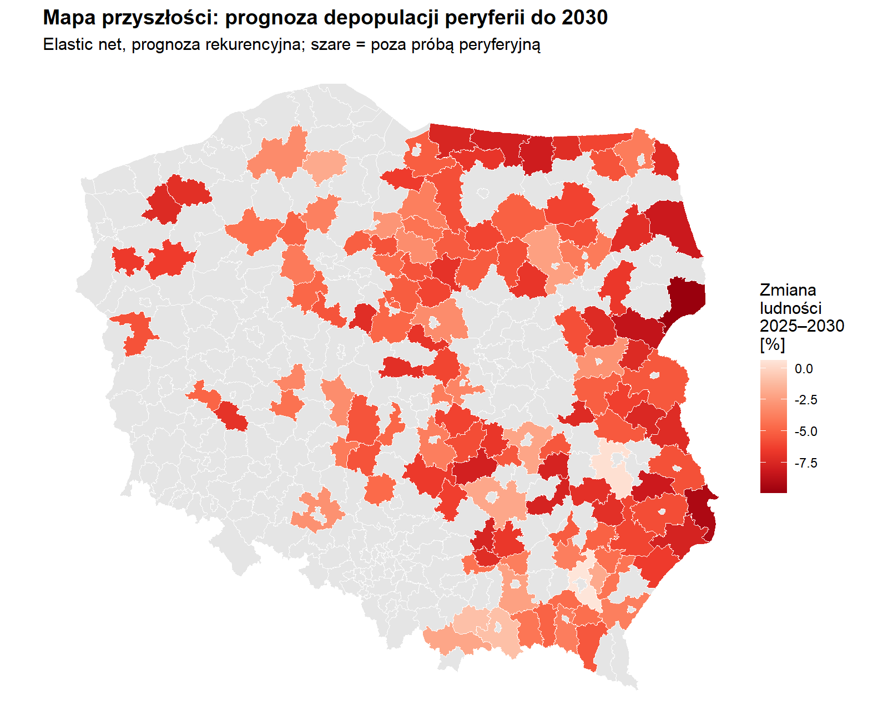

# Mapa przyszłości regionów: depopulacja powiatów peryferyjnych (GIS + ML)

Prognoza depopulacji powiatów peryferyjnych w Polsce do 2030 r. z wykorzystaniem GIS, uczenia maszynowego
i ekonometrii przestrzennej. Projekt zespołu ID-1362.

**[Interaktywny raport](https://dawid27g.github.io/depopulacja-peryferii-gis-ml/)**: mapy, wykresy i symulator
interwencji działają w przeglądarce, bez instalowania czegokolwiek.



## Pytanie badawcze

Czy wzrost peryferyjności powiatu (niski dochód, słaby rynek pracy, starzenie się ludności, słabsza dostępność
usług i większa odległość od ośrodków) wiąże się z szybszym odpływem mieszkańców? Jak zmieni się ludność
powiatów peryferyjnych do 2030 r. i co mogłoby ten proces spowolnić?

## Główne wyniki

- **Prognoza:** powiaty peryferyjne (127 z 380) stracą do 2030 r. średnio ok. **5,3%** mieszkańców.
  Najbardziej zagrożone są powiaty hajnowski, hrubieszowski, siemiatycki, sokólski i krasnostawski, głównie
  wzdłuż wschodniej granicy.
- **Wybór modelu:** spośród 13 modeli porównanych w walidacji kroczącej 2019–2024 najniższy średni błąd ma
  **elastic net**. Jest istotnie lepszy od panelowego modelu efektów stałych (test Diebolda-Mariano z korektą
  Holma). XGBoost, Random Forest, sieć neuronowa i modele geograficzne nie są lepsze nawet po strojeniu.
  Między czołowymi modelami różnice są jednak mniejsze niż wpływ wstrząsów rocznych (COVID, uchodźcy),
  więc przy 6 latach testowych nie da się ich wiarygodnie uszeregować (test wyboru zagnieżdżonego
  i na odłożonych latach 2023–2024 w raporcie).
- **Czynniki:** największy efekt ma **starzenie się ludności**. Działa progowo: najsilniej do ok. 19% osób 65+.
  Liczy się też odległość od miasta wojewódzkiego (do ok. 41 km), bezrobocie i gęstość zaludnienia.
- **Scenariusze:** spadek bezrobocia o 2 pp i skrócenie dystansu do miasta wojewódzkiego o 20% to dźwignie
  o istotnym efekcie (bootstrap blokowy po powiatach). Pakiet interwencji hamuje depopulację o ok. 0,4‰ rocznie,
  ale jej nie odwraca.

Pełny opis metod, testów i ograniczeń jest w raporcie.

## Metody

| Pytanie | Model |
|---|---|
| Jak zmieni się ludność do 2030 r.? | elastic net z doborem α i λ w czasie (walidacja ex ante) |
| Jakie czynniki i w którą stronę? | pooled OLS, panel FE, przestrzenny model Durbina (SDM) |
| Gdzie są progi i nieliniowości? | XGBoost + krzywe ALE |
| Czy mechanizm różni się w przestrzeni? | GW-XGBoost (lokalne SHAP, testy permutacyjne z FDR) |
| Co dałyby interwencje? | hybryda: elastic net + progi z ALE, istotność z bootstrapu |

Wszystkie porównania modeli używają walidacji kroczącej (uczenie na latach wcześniejszych, test na
2019–2024). Hiperparametry są strojone wyłącznie na latach 2017–2018. Artefakty zmian granic administracyjnych
wykrywane są z bilansu ludności (zmiana ludności ≠ przyrost naturalny + saldo migracji).

## Struktura repozytorium

| Plik / folder | Zawartość |
|---|---|
| `analiza_peryferyjnosc.R` | cała analiza: czyszczenie danych, klasyfikacja, modele, prognoza, scenariusze, mapy |
| `RAPORT_ANALIZA_PERYFERYJNOSC.Rmd` | źródło raportu (R Markdown) |
| `RAPORT_ANALIZA_PERYFERYJNOSC.html` | wygenerowany interaktywny raport |
| `outputs/` | tabele (CSV) i rysunki (PNG) generowane przez skrypt, z których korzysta raport |
| `dataset.xlsx`, `dataset_demografia_depopulacja.xlsx`, `dml_panel_ml.csv` | dane panelowe powiatów |
| `powiaty.geojson`, `centroidy_powiatow.csv`, `powiaty_mapowanie_kodow.csv` | granice i centroidy powiatów |
| `PAKIETY_R.txt` | lista pakietów R z wersjami |

## Jak uruchomić

Wymagany R ≥ 4.4 i pakiety z pliku `PAKIETY_R.txt`. W folderze repozytorium:

```
Rscript analiza_peryferyjnosc.R
Rscript -e "rmarkdown::render('RAPORT_ANALIZA_PERYFERYJNOSC.Rmd')"
```

Pełny przebieg skryptu trwa ok. 50 minut (random search XGBoost, bootstrap, GW-XGBoost). Sam raport
renderuje się z gotowych plików w `outputs/` w ok. minutę.

## Dane

- Wskaźniki społeczno-gospodarcze i demograficzne powiatów, lata 2010–2024: GUS, Bank Danych Lokalnych (BDL).
- Granice powiatów: Państwowy Rejestr Granic (PRG), GUGiK.

## Licencja

Kod: MIT (plik `LICENSE`). Dane pochodzą ze źródeł publicznych i podlegają ich warunkom.
